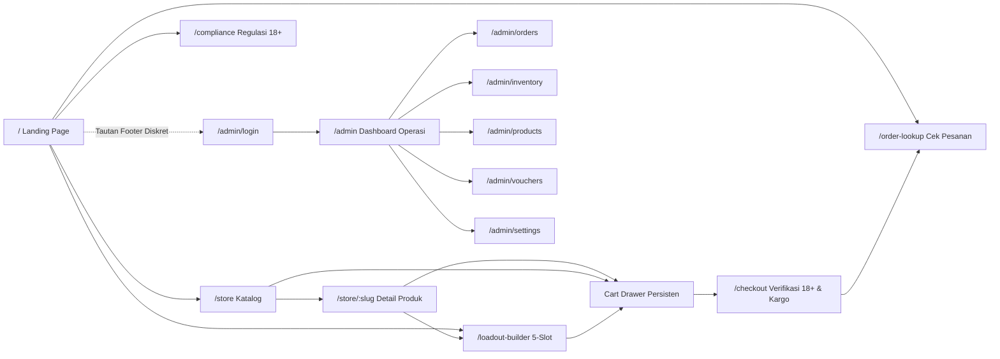

# Spesifikasi UX Mendalam: Brakasa Tactical

Dokumen ini menetapkan spesifikasi pengalaman pengguna (UX), arsitektur informasi, tata letak responsif 3-state, ergonomi Hero Video taktis, alur pembelian spesialis airsoft dan perlengkapan taktis, antarmuka Admin Operations Center berbasis keputusan, serta standar aksesibilitas manusia untuk seluruh platform **Brakasa Tactical**.

Seluruh keputusan UX di dokumen ini mengacu langsung pada hasil riset domain (`01-tactical-store-benchmarks.md`), referensi studio manusia & aturan anti-AI-slop (`02-ai-ux-ui-references.md`), peta fitur produk & admin (`03-store-admin-features.md`), serta audit teknis pipeline media (`04-tech-and-video-pipeline.md`).

---

## Ringkasan Arah UX & Prinsip Pengikat

Brakasa Tactical melayani pembeli berorientasi spesifikasi (*spec-literate buyers*) di ekosistem olahraga airsoft 18+ Indonesia dan staf operasional armory. Pengalaman antarmuka menolak template SaaS generik dan berpegang pada lima prinsip pengikat:

1. **Zero Dead Ends (`R-24`, `R-26`)**: Setiap tautan navigasi, filter, tab, tombol aksi, dan kontrol video memiliki tujuan nyata yang berjalan penuh. Tidak ada menu dekoratif, tautan `#`, atau menu tiga titik kosong.
2. **True 3-State Reflow (`R-03`, `antislop-layoutmobile`)**: Mobile (`< 640px`), Tablet/Small Laptop (`640px - 1024px`), dan Desktop (`> 1024px`) masing-masing memiliki rancangan susunan, ukuran ruang, dan interaksi sendiri, bukan desktop yang diperkecil.
3. **Zero Compatibility & Compliance Anxiety**: Pembeli selalu melihat data teknis terukur (FPS, Joule, propulsi, konektor, ulir, berat, kelas pengiriman) sebelum memasukkan barang ke keranjang, dilengkapi validasi kompatibilitas otomatis di Loadout Builder dan alur kepatuhan 18+ Perpol No. 5 Tahun 2018 yang lugas di Checkout.
4. **Decision-First Operations (`antislop-ui` App & Dashboard)**: Layar Admin dimulai dari keputusan kerja harian (verifikasi pesanan, input resi pengiriman, dan restock SKU kritis), bukan barisan 4 kartu stat generik atau angka karangan.
5. **Human-First Accessibility (`antislop-human` R-25, R-27, R-32, R-34, R-39)**: Seluruh informasi status tidak pernah mengandalkan warna saja, seluruh alur dapat dioperasikan dengan keyboard, kontras lulus WCAG AA di Armory Dark dan Field Paper Light, dan setiap tampilan data memiliki state Loading, Empty, serta Error yang bermakna.

**Design Read & Liveliness Dials Acuan:**
- **Landing Page (`/`)**: `ENERGY 3 / RHYTHM 3 / MOTION 2` (editorial taktis asimetris, 6 seksi berbeda struktur).
- **Storefront, PDP, Loadout Builder, Checkout & Lookup**: `ENERGY 2 / RHYTHM 2 / MOTION 1` (indeks katalog teknis berkecepatan pindai tinggi).
- **Admin Operations Center (`/admin/*`)**: `ENERGY 1 / RHYTHM 1 / MOTION 1` (tenang, padat data keputusan, bebas gangguan visual).

---

## 1. Arsitektur Informasi & Peta Navigasi Nyata (Patuh R-24)

Seluruh rute aplikasi dipetakan secara eksplisit menjadi dua domain terpisah: **Storefront Publik** (7 rute halaman + Persistent Cart Drawer global) dan **Admin Operations Center** (7 rute utama + tampilan detail pesanan terproteksi sesi cookie `HttpOnly`).

### 1.1 Peta Rute Publik (7 Rute Nyata + Cart Drawer)

| Rute | Judul Dokumen (`<title>`) | `<h1>` Tunggal Halaman | Tujuan UX Utama | Sumber Data Nyata |
| :--- | :--- | :--- | :--- | :--- |
| `/` | `Brakasa Tactical \| Unit Airsoft & Perlengkapan Taktis Presisi` | `Unit Airsoft & Perlengkapan Taktis Berstandar Presisi Lapangan` | Membangun otoritas produk lewat Hero Video 10-scene, jalur eksplorasi misi, Interactive Loadout Spotlight, Field Video Showcase, ringkasan kepatuhan + kalkulator FPS-Joule, dan 5 FAQ spesifik RI. | `GET /api/bootstrap`, `GET /api/products` |
| `/store` | `Katalog Unit & Gear \| Brakasa Tactical` | `Katalog Armory Brakasa Tactical` | Pencarian instan FTS5 dan penyaringan multi-dimensi URL-synced (Kategori, Misi, Platform, Propulsi, Rentang FPS, Status Stok, Harga, Ada Video Demo) dengan kartu produk ber-spec ringkas. | `GET /api/products` |
| `/store/:slug` | `[Nama Produk] \| Brakasa Tactical` | `[Nama Produk]` | Inspeksi produk mendalam split-screen (Galeri Foto + Video Demo), matriks spesifikasi cepat, transparansi Isi Paket vs Kebutuhan Tambahan, tabel spec JSON, kompatibilitas, dan produk pelengkap satu rig. | `GET /api/products/:slug` |
| `/loadout-builder` | `Loadout Builder 5-Slot \| Brakasa Tactical` | `Interactive Tactical Loadout Builder` | Merakit 5 slot taktis (Primary, Sidearm, Optic, Rig & Protection, Consumables & Muzzle) dengan 3 preset misi, pengecekan kompatibilitas real-time, total berat (g/kg), total harga IDR, dan 1-klik tambah ke keranjang. | `GET /api/products`, `POST /api/loadout/evaluate` |
| `/checkout` | `Checkout & Verifikasi 18+ \| Brakasa Tactical` | `Checkout Pesanan & Verifikasi Kepatuhan` | Menyelesaikan transaksi tamu: alamat kirim, verifikasi tanggal lahir >= 18 tahun & deklarasi Perpol No. 5/2018, penguncian kargo darat/laut + packing kayu, validasi voucher, dan pembuatan invoice atomik. | `POST /api/vouchers/validate`, `POST /api/orders` |
| `/order-lookup` | `Cek Status Pesanan \| Brakasa Tactical` | `Cek Status Pesanan` | Pelacakan pesanan tamu melalui verifikasi 2 bidang (Nomor Invoice + Email/No. HP), menampilkan stepper 5 status, nomor resi ekspedisi + salin, rincian item, dan cetak ringkasan invoice. | `POST /api/orders/lookup` |
| `/compliance` | `Kepatuhan Regulasi 18+ & Kargo Darat \| Brakasa Tactical` | `Panduan Regulasi Airsoft 18+, Keselamatan & Pengiriman Kargo` | Pusat edukasi hukum dan etika olahraga airsoft RI (Perpol No. 5/2018, Perkap No. 8/2012, Perpol No. 1/2022, batas <= 2.0 J, orange tip, klub resmi PERBAKIN/PORGASI/ABU/INNASSOC/FAI, SOP transportasi tertutup, kebijakan kargo darat/laut, syarat & privasi). | Statis terkurasi + kalkulator FPS-Joule klien + kontak dari `GET /api/bootstrap` |
| *(Global Drawer)* | *(Dialog di atas rute aktif)* | `Keranjang Belanja` (`<h2>` di `<dialog>`) | Keranjang persisten `localStorage` tervalidasi live (harga terbaru, batas stok, deteksi wajib 18+ dan kargo darat), penyesuaian kuantitas, dan tombol lanjut ke `/checkout`. | `localStorage` + validasi produk live |

*Aturan Zero Dead Link*: Tidak ada rute `/about`, `/blog`, `/careers`, `/wishlist`, atau `/account` yang tidak dibangun. Seluruh tautan di navbar, konten halaman, dan footer HANYA menunjuk ke salah satu dari 7 rute publik di atas, tautan berparameter valid ke `/store?...`, atau tautan diskret `/admin` di footer.

### 1.2 Peta Rute Admin Operations Center (7 Rute Utama)

Semua rute di bawah `/admin` (kecuali `/admin/login`) memeriksa sesi cookie `HttpOnly` lewat `GET /api/admin/auth/me`. Sesi tidak valid langsung mengarahkan ke `/admin/login` sambil menyimpan tujuan rute untuk dikembalikan setelah login berhasil.

| Rute | Judul Dokumen (`<title>`) | `<h1>` Tunggal Halaman | Kelompok Sidebar | Tujuan Keputusan Operasional |
| :--- | :--- | :--- | :--- | :--- |
| `/admin/login` | `Masuk Admin \| Brakasa Tactical` | `Masuk Pusat Operasi Armory` | *(Tanpa sidebar)* | Autentikasi staf armory via email/username + kata sandi tanpa bocoran kredensial pada pesan galat. |
| `/admin` | `Dashboard Operasi \| Admin Brakasa` | `Pusat Operasi Armory` | `OPERASIONAL` | Menyelesaikan antrean pesanan butuh tindakan dan melakukan restock cepat SKU kritis/habis, diikuti metrik SQL riil. |
| `/admin/orders` | `Manajemen Pesanan \| Admin Brakasa` | `Manajemen Pesanan` | `OPERASIONAL` | Memfilter pesanan per status, memverifikasi pembayaran & kepatuhan 18+, memperbarui status (`PACKED`, `SHIPPED` wajib resi, `COMPLETED`), dan membatalkan pesanan (`CANCELLED` auto-restock). *(Detail pesanan dibuka via Drawer/Panel Detail atau sub-rute `/admin/orders/:id` yang terhubung langsung ke tabel ini).* |
| `/admin/inventory` | `Inventori & Mutasi Stok \| Admin Brakasa` | `Inventori & Buku Mutasi Stok` | `OPERASIONAL` | Memantau stok seluruh SKU, melakukan Restock (`+`) dan Koreksi Stok (`+/-`) ber-alasan wajib, serta mengaudit tabel riwayat `inventory_mutations`. |
| `/admin/products` | `Manajemen Produk \| Admin Brakasa` | `Manajemen Produk & Media` | `KATALOG` | Menambah/mengubah/mengarsipkan produk, mengedit spec & compatibility JSON terpandu, serta mengunggah/memilih gambar dan video demo produk. |
| `/admin/vouchers` | `Manajemen Voucher \| Admin Brakasa` | `Manajemen Voucher & Promo` | `KATALOG` | Membuat, mengubah, mengaktifkan/menonaktifkan kode promo (`BRAKASA10`, `CQBREADY`, `KARGOFREE`) dan memantau kuota pemakaian riil. |
| `/admin/settings` | `Pengaturan Toko & Hero \| Admin Brakasa` | `Pengaturan Armory & Hero Video` | `SISTEM` | Mengelola profil armory, URL video & poster Hero, daftar 10 Telemetry Scenes, konfigurasi Loadout Spotlight, serta tarif kargo darat dan packing kayu. |

### 1.3 Struktur Navigasi Global Tanpa Link Mati

#### A. Header Storefront Publik
- **Kiri**: Wordmark `<a href="/">BRAKASA // TACTICAL</a>` (hanya teks/logo merek, BUKAN `<h1>`).
- **Tengah (Desktop `> 1024px`)**: `<nav aria-label="Navigasi utama">` berisi 4 tautan datar yang 100% aktif:
  1. `Katalog` (`/store`)
  2. `Loadout Builder` (`/loadout-builder`)
  3. `Cek Pesanan` (`/order-lookup`)
  4. `Kepatuhan 18+` (`/compliance`)
- **Kanan**:
  - Tombol Pencarian Instan (Desktop: input ringkas atau trigger modal pencarian cepat `Ctrl+K` / klik; Mobile/Tablet: tombol ikon+label/aria-label `44x44px`).
  - Toggle Tema Dual-Mode (`Armory Dark` / `Field Paper Light`) dengan `aria-pressed` dan teks/aria-label eksplisit.
  - Tombol Trigger Keranjang: `Keranjang [N]` (membuka Cart Drawer, angka `[N]` tabular mono, `aria-label="Buka keranjang belanja, N item"`).
  - Di Mobile & Tablet (`<= 1024px`): Tombol eksplisit berlabel **`Menu`** (`44x44px`, `aria-expanded`, `aria-controls="public-mobile-nav"`).

#### B. Footer Fungsional Publik (Anti 4-Kolom Template Kosong)
Alih-alih memaksakan kolom generik (`Product / Company / Resources / Legal`) yang penuh link mati, footer Brakasa Tactical menggunakan **3 kolom pragmatis + bilah kepatuhan bawah** yang 100% bertaut ke rute nyata:
1. **Kolom 1 - Identitas Armory & Kepatuhan 18+**: Wordmark, ringkasan tegas bahwa Brakasa Tactical hanya menjual replika olahraga airsoft 6mm `<= 2.0 Joule` khusus 18+ (bukan senjata api nyata dan bukan airgun gotri logam), alamat operasional, jam layanan, dan kontak dari `site_settings`.
2. **Kolom 2 - Indeks Katalog Nyata**: Tautan terfilter langsung ke `/store`, `/store?mission=cqb&maxFps=350` (CQB Legal), `/store?mission=woodland-recce` (Woodland Recce), `/store?mission=rig-protection` (Plate Carrier & Rig), dan `/store?hasVideo=true` (Produk Dengan Video Demo).
3. **Kolom 3 - Layanan & Kepatuhan**: Tautan nyata ke `/loadout-builder` (Loadout Builder 5-Slot), `/order-lookup` (Cek Status Pesanan), `/compliance` (Regulasi Perpol No. 5/2018 & Kargo Darat), serta tautan teks tenang `Portal Admin` (`/admin/login` atau `/admin`).

#### C. Alur Navigasi Utama



---

## 2. Desain Layout Responsif 3-State Nyata (Patuh R-03 & `antislop-layoutmobile`)

Sesuai `antislop-layoutmobile`, **layout mobile adalah layout tersendiri yang dirancang ulang**, bukan desktop yang diperkecil. Setiap halaman wajib lolos transisi mulus di seluruh rentang lebar layar (diuji dari `360px`, `390px`, `640px`, `768px`, `1024px`, `1280px`, hingga `1440px`) dengan **nol horizontal overflow halaman**.

### 2.1 Rentang Breakpoint & Skala Ruang Responsif

Breakpoint ditempatkan pada titik ketika struktur konten benar-benar membutuhkan perubahan kolom, bukan meniru satu model perangkat saja:

| State Layout | Rentang Lebar | Max Container & Gutter | Padding Seksi Vertikal | Skala Grid Utama | Aturan Kunci |
| :--- | :--- | :--- | :--- | :--- | :--- |
| **State 1: Mobile** | `< 640px` (`360px - 639px`) | `100%`, padding samping `16px` (`1rem`) | `40px - 56px` (`2.5rem - 3.5rem`), bukan `96px+` | 1 kolom penuh (maks 2 kolom hanya untuk micro-spec 2x3 di PDP) | Header `56px` kompak, menu & filter dalam Sheet/Drawer, tombol >= `44x44px`, gap >= `8px`. |
| **State 2: Tablet / Small Laptop** | `640px - 1024px` | `100%`, padding samping `24px` (`1.5rem`) | `56px - 72px` (`3.5rem - 4.5rem`) | 2 kolom seimbang untuk katalog, spotlight, dan ringkasan | Tidak boleh mewarisi 1-kolom terlalu lebar ataupun 4-kolom sempit. Filter & Admin Sidebar memakai trigger sheet/collapsed rail. |
| **State 3: Desktop** | `> 1024px` (`1025px - 1440px+`) | `max-width: 1360px`, padding samping `32px` (`2rem`) | `72px - 96px` (`4.5rem - 6rem`) bervariasi antar seksi | Asimetris 12-kolom (Landing), `280px + 1fr` (Store), `60/40` (PDP), `65/35` (Builder), `248px + 1fr` (Admin) | Rail filter dan panel ringkasan memakai `position: sticky` dengan `top` memperhitungkan tinggi header. |

**Aturan Anti-Overflow & Anti-`100vh` Wajib:**
- Semua anak flex/grid diberi `min-width: 0` agar teks panjang (SKU, judul produk, nomor resi) dapat membungkus (`overflow-wrap: anywhere`) alih-alih mendobrak lebar viewport.
- Dilarang memakai `height: 100vh` pada Hero atau seksi halaman. Gunakan `min-height: clamp(560px, 84svh, 860px)` di desktop, `clamp(520px, 76svh, 720px)` di tablet, dan `min-height: auto` (atau `min-height: 70svh`) di mobile agar bilah alamat browser mobile tidak memotong CTA.
- Semua gambar/video memakai `max-width: 100%`, dimensi eksplisit (`width`/`height`), dan `aspect-ratio` terkunci (`16/9` untuk hero, produk, dan video demo).
- Tabel data panjang (Spec Sheet, Tabel FPS, Tabel Admin) berada dalam wadah `overflow-x: auto` terisolasi (bukan seluruh `<body>`) atau melakukan reflow ke daftar kartu di mobile.

### 2.2 Matriks Reflow 3-State Nyata Per Halaman

| Halaman / Modul | State Mobile (`< 640px`) | State Tablet / Small Laptop (`640px - 1024px`) | State Desktop (`> 1024px`) |
| :--- | :--- | :--- | :--- |
| **Navbar Publik** | Bar lengket `56px`: Wordmark kiri; kanan: tombol Cari (`44x44px`), Cart `[N]` (`44x44px`), dan tombol berlabel **`Menu`** (`>= 44x44px`). Menekan `Menu` membuka Slide-Over Sheet penuh berisi 4 tautan utama + `/compliance` + Theme Toggle + tombol **`Tutup`**. | Bar lengket `60px`: Wordmark kiri; kanan: tombol Cari + Theme Toggle + Cart `[N]` + tombol **`Menu`** (atau di `>= 900px` menampilkan 4 tautan ringkas jika ruang cukup tanpa wrap 2 baris). | Bar lengket `64px`: Wordmark kiri; 4 tautan utama di tengah; kanan: Search trigger/input, Theme Toggle, dan tombol `Keranjang [N]`. |
| **Landing: Hero Video** | Media video/poster `16:9` utuh atau latar `min-height: 72svh` dengan scrim vertikal bawah (`92% -> 84% -> 30%`). Teks H1, subheadline, 2 CTA stack penuh (`width: 100%`, `min-height: 48px`), bar kontrol Play/Pause & Audio, lalu Switcher Scene kompak (`Prev / 0X / Next` + pita chip 01..10 scroll-snap). | `min-height: clamp(520px, 76svh, 720px)`, zona teks kiri `max-width: 540px` di atas scrim `>= 82%`, kontrol Play/Pause & Audio di kanan bawah, Switcher Scene 10 tombol kompak di dasar hero. | `min-height: clamp(580px, 84svh, 860px)`, zona teks kiri `max-width: 600px` di atas scrim horizontal+vertikal `>= 82%`, kanan atas tetap terbuka menampilkan aksi video, Switcher Telemetry 10 scene + metadata aktif di dasar hero, Play/Pause & Audio permanen di kanan bawah. |
| **Landing: Shop by Mission** | 1 kolom vertikal; tiap misi tampil sebagai panel horizontal ringkas menampilkan nama misi, rentang FPS, jumlah SKU live, dan 1 tautan filter. | Grid 2x2 berimbang dengan bobot tipografi jelas antara misi utama (CQB & Woodland) dan pendukung. | Grid asimetris 12-kolom: baris 1 rasio `7:5` (CQB & Woodland Recce), baris 2 rasio `5:7` (SpeedQB & Rig Protection), mencegah monoton 4 kartu seragam. |
| **Landing: Loadout Spotlight** | Gambar operator `16:9` di atas dengan penanda nomor `01..05`; di bawah gambar tampil **daftar tab hotspot** (`min-height: 44px`, fat-finger safe) yang mengganti panel inspeksi produk aktif + tombol aksi kolektif. | Split vertikal atau 2 kolom (`55%` visual hotspot, `45%` panel inspeksi aktif) pada `>= 820px`. | Split asimetris `7:5` (`58%` visual operator dengan 5 tombol hotspot koordinat presisi `44x44px` hit-area, `42%` panel inspeksi produk live + tombol `Muat Rig Ini di Loadout Builder`). |
| **Landing: Field Video & Compliance** | Field Video: pemutar utama `16:9` di atas + daftar pilih video horizontal/stack di bawah. Compliance: tabel FPS-Joule berpindah ke kartu ringkas per kelas + kalkulator 1 kolom. | Field Video: pemutar utama penuh di atas + grid 2 kolom daftar video di bawah. Compliance: split 2 kolom antara ringkasan hukum & kalkulator FPS. | Field Video: split `8:4` (pemutar utama besar di kiri + playlist 4-6 video produk di kanan). Compliance: split `7:5` (tabel FPS-Joule & ringkasan Perpol 5/2018 di kiri, kalkulator interaktif + 5 FAQ accordion di kanan). |
| **Storefront (`/store`)** | Bar utilitas lengket kompak (Input Cari + baris tombol **`Filter (N)`** `>= 44px` + Select Urutkan `>= 44px`). Filter terbuka sebagai **Bottom Sheet** (`85dvh`, tombol `Terapkan Filter (N)` sticky di bawah). Active chips membungkus rapi. Grid produk **1 kolom** (atau kartu daftar padat informasi dengan foto `16:9`). | Bar utilitas atas dengan Search, tombol **`Filter (N)`** membuka **Slide-Over Filter Sheet** dari kiri (`360px`), dan Select Urutkan. Grid produk **2 kolom** (`repeat(2, minmax(0, 1fr))`, gap `20px`). | Layout 2 kolom: **Sticky Left Filter Rail (`280px`)** selalu terlihat + area katalog `1fr` dengan grid produk **3 kolom** (`1025px - 1320px`) dan **3-4 kolom** (`> 1320px`, kartu minimal `280px` agar baris micro-spec tidak patah). |
| **PDP (`/store/:slug`)** | 1 kolom terurut: Breadcrumb -> Galeri 16:9 (tombol Prev/Next `44x44px` + tab Foto/Video Demo) -> Judul, SKU, Badge Kepatuhan, Harga -> Quick Spec Grid 2x3 -> Qty + CTA Beli & Builder -> Blok Isi Paket vs Kebutuhan Tambahan -> ARIA Tabs/Accordion Spec -> Compatible Rig Pairings (1 kolom). | Di `640px - 860px`: Galeri penuh di atas, diikuti Buy Box 2 kolom ringkas; di `861px - 1024px`: Split `52/48`. Compatible Rig Pairings 2 kolom. | Split-screen asimetris **60/40** (`minmax(0, 1.45fr) minmax(360px, 1fr)`): Galeri Foto+Video di kiri, Buy Box & Quick Spec sticky di kanan. Di bawah lipatan: ARIA Tabs (`Spesifikasi Teknis`, `Kompatibilitas`, `Regulasi & Kargo`) + Compatible Pairings 3-4 kolom. |
| **Loadout Builder (`/loadout-builder`)** | Preset misi sebagai tombol wrap (`min-height: 44px`). 5 Slot tersusun vertikal 1 kolom; menekan `Pilih / Ganti Item` membuka **Picker Sheet penuh** dengan filter & badge kecocokan. Di bawah layar hadir **Sticky Compact Manifest Bar** (`64px` + `safe-area-inset-bottom`, halaman diberi `padding-bottom: 96px`) dengan tombol **`Ringkasan & Tambah`** yang membuka Manifest Bottom Sheet. | Preset bar di atas; 5 Slot di kolom utama (picker membuka modal 2 kolom); di `>= 900px` Manifest Panel tampil di kolom kanan (`320px` sticky), di `< 900px` menggunakan Sticky Compact Manifest Bar + Sheet. | Split **65/35** (`minmax(0, 1fr) 380px`): Bar 3 Preset di puncak; kiri berisi 5 Kartu Slot dengan picker inline/modal berfilter; kanan berisi **Sticky Tactical Manifest Panel** (Total Berat + kelas beban, Status Kompatibilitas, Rincian Harga, Kelas Kargo, CTA `Tambahkan Seluruh Loadout ke Keranjang` & `Salin Tautan Build`). |
| **Checkout (`/checkout`)** | 1 kolom penuh. Accordion **`Ringkasan Pesanan (N item - Rp ...)`** di puncak halaman (expandable). 4 blok form bernomor (Alamat, Verifikasi 18+ & Deklarasi, Kargo Darat & Packing Kayu, Voucher & Bayar) dengan input `min-height: 48px`, `padding-bottom: 120px` agar keyboard virtual tidak menutup input terakhir. | Di `640px - 899px`: 1 kolom lapang (`max-width: 720px`) dengan Accordion Ringkasan di atas; di `900px - 1024px`: Split `1.15fr / 0.85fr` dengan ringkasan sticky. | Split **58/42** (`minmax(0, 1.35fr) minmax(340px, 1fr)`): 4 blok form bernomor di kiri, Ringkasan Pesanan + Rincian Ongkir/Diskon + Grand Total sticky di kanan. |
| **Order Lookup (`/order-lookup`)** | Form 2 bidang bertumpuk 1 kolom (`Invoice`, `Email / No. HP`, tombol `Cek Status Pesanan` penuh). Hasil menampilkan kartu ringkasan + kotak Resi menonjol + **Stepper 5 Tahap Vertikal** + daftar item ringkas. | Form 2 bidang sejajar 2 kolom + tombol penuh/kanan (`max-width: 760px`). Hasil memakai Stepper 5 Tahap Horizontal kompak + rincian item & biaya 2 kolom. | Form terstruktur di puncak (`max-width: 820px`). Hasil memakai kartu status lebar + **Stepper 5 Tahap Horizontal** + split `60/40` (Daftar Item & Audit Timeline kiri, Ringkasan Biaya & Info Kargo kanan) + tombol `Cetak Ringkasan Invoice`. |
| **Admin Shell & Dashboard (`/admin/*`)** | Header lengket `56px`: tombol **`Menu Admin`** (`>= 44x44px`, ikon + teks) membuka **Slide-Over Navigation Sheet** dari kiri + judul halaman + tombol Refresh. Konten 1 kolom: Antrean Pesanan (reflow ke **Action Cards** dengan tombol proses langsung) -> Peringatan Stok Kritis (kartu dengan tombol `Restock Cepat`) -> Metrik SQL 2x2 -> Mutasi Terbaru. | Sidebar default **Collapsed Icon Rail (`68px`)** dengan tombol expand `aria-expanded` (atau Slide-Over Sheet di `< 768px`). Dashboard 1 kolom di `< 900px` dan 2 kolom `55/45` di `>= 900px`. Tabel data menggunakan wadah `overflow-x: auto` dengan kolom aksi tetap mudah dijangkau. | **Collapsible Sidebar Rail** (`248px` expanded / `68px` collapsed) di kiri + Top Operational Bar (`56px`) + Workspace `1fr`. Dashboard memakai split **60/40** di atas lipatan (Antrean Pesanan Butuh Tindakan kiri, Peringatan SKU Stok Kritis kanan), diikuti Strip 4 Metrik SQL Riil dan blok Distribusi Status + Mutasi Stok. |

### 2.3 Spesifikasi Detail Sheet & Drawer Mobile (Patuh R-03, R-26, R-32)

1. **Public Mobile Navigation Sheet (`#public-mobile-nav`)**:
   - **Trigger**: `<button type="button" aria-expanded="false" aria-controls="public-mobile-nav">` menampilkan ikon garis 3 + teks terlihat **`Menu`** (bukan ikon hamburger telanjang). Ukuran minimal `44x44px` (lebar aktual ~`82px x 44px`).
   - **Anatomi Sheet**: Panel slide-over dari kanan (`width: min(86vw, 340px)`, tinggi `100dvh`), latar `--bg-elevated`, backdrop gelap `rgba(15, 17, 16, 0.72)`. Header sheet berisi wordmark dan tombol tutup eksplisit **`Tutup`** (`>= 44x44px`, `aria-label="Tutup menu navigasi"`).
   - **Isi**: 5 tautan rute publik nyata (`Beranda`, `Katalog Unit & Gear`, `Loadout Builder 5-Slot`, `Cek Status Pesanan`, `Kepatuhan 18+ & Kargo`) dengan tinggi tiap baris `min-height: 48px`, status halaman aktif ditandai `aria-current="page"` + bar aksen kiri `3px` + bobot font `600`, diikuti pemisah dan kontrol Toggle Tema (`Mode Gelap` / `Mode Terang`) dengan tinggi `48px`.
   - **Keyboard & Fokus**: Saat terbuka, fokus berpindah ke tombol `Tutup` (atau judul sheet), `Tab`/`Shift+Tab` terperangkap di dalam sheet (focus trap), `Escape` atau klik backdrop menutup sheet dan **mengembalikan fokus ke tombol `Menu`**.

2. **Storefront Filter Bottom Sheet (Mobile) / Slide-Over Sheet (Tablet)**:
   - **Trigger**: Tombol **`Filter`** (berubah menjadi **`Filter (3)`** saat ada 3 filter aktif), ukuran minimal `96px x 44px`, terletak sejajar dengan dropdown `Urutkan`.
   - **Anatomi**: Di Mobile (`< 640px`), muncul dari bawah (`height: min(85dvh, 680px)`, radius atas `6px`, tanpa handle drag-only; wajib punya header jelas **`Filter Katalog`** + tombol **`Tutup`** `44x44px`). Di Tablet (`640px - 1024px`), muncul sebagai slide-over kiri `360px`.
   - **Footer Sticky Sheet**: Dua tombol sejajar dengan jarak `12px`: **`Reset`** (sekunder, `min-height: 44px`) dan **`Terapkan Filter (N Produk)`** (aksen utama, `min-height: 44px`, menampilkan jumlah hasil pratinjau/terhitung).
   - **Penutupan**: Tombol `Terapkan`, tombol `Tutup`, klik backdrop, dan tombol `Escape` menutup sheet dan mengembalikan fokus ke tombol trigger `Filter`.

3. **Admin Mobile Slide-Over Sheet (`#admin-nav-sheet`)**:
   - **Trigger**: Di `< 768px`, header admin menampilkan tombol berlabel jelas **`Menu Admin`** (`min-height: 44px`, `aria-expanded`, `aria-controls="admin-nav-sheet"`). Tidak ada rail yang menghilang tanpa trigger!
   - **Isi**: Menampilkan identitas admin yang sedang login (nama/role), 3 grup navigasi berlabel tenang (`OPERASIONAL`, `KATALOG`, `SISTEM`), tautan `Lihat Storefront` (tab sama/jelas), dan tombol **`Keluar`** di bagian bawah. Tinggi setiap baris `>= 48px`, mendukung focus trap, `Escape`, dan return focus ke tombol `Menu Admin`.

### 2.4 Standar Target Sentuh, Safe Area & Keyboard Virtual Mobile

- **Ukuran Minimal**: Seluruh elemen yang dapat diketuk (`button`, `a`, `input[type="checkbox"]` melalui `<label>`, tab scene, tombol +/- kuantitas, tombol tutup modal, hotspot tab) memiliki luas sentuh minimal **`44px x 44px`**. Bila tampilan visual ikon hanya `20px`, gunakan padding atau hit-box CSS sehingga dimensi bounding box klik tetap `>= 44x44px`.
- **Jarak Aman Antar Target**: Minimal **`8px`** (`gap: 0.5rem`) antar tombol bersebelahan (mis. antara Play/Pause dan Audio On/Off, antara tombol `-` dan `+` kuantitas, antara tab filter, dan antara tombol aksi di tabel admin) untuk mencegah kesalahan ketuk ibu jari.
- **Anti Hover-Only**: Tidak ada aksi penting (seperti tombol `+ Keranjang`, pratinjau video, atau tooltip spesifikasi) yang hanya muncul saat `:hover`. Di perangkat sentuh, semua tombol aksi tampil langsung dan memiliki umpan balik `:active` (`transform: translateY(1px)` / perubahan warna batas seketika).
- **Safe Area & Sticky Bars**: Setiap bar bawah lengket di mobile (seperti Manifest Bar di Loadout Builder) wajib memakai `padding-bottom: max(12px, env(safe-area-inset-bottom))` dan wadah konten utama wajib diberi `padding-bottom` minimal setinggi bar + `24px` agar item terbawah maupun footer tidak pernah tertutup.
- **Perlindungan Keyboard Virtual Mobile**: Pada halaman `/checkout`, `/order-lookup`, `/admin/login`, dan form modal admin, setiap input memakai `scroll-margin-block: 96px` serta ruang gulir bawah memadai (`padding-bottom: 120px` di mobile) agar field yang difokuskan otomatis tergulir di atas keyboard layar sentuh.

---

## 3. Ergonomi Hero Video Taktis `<= 30` Detik (10 Scene Fast-Cut `2.2-2.8s`)

Hero Video Brakasa Tactical berdurasi **24,0 detik** (`<= 30 detik`), terdiri dari **10 scene aksi cepat** (`2.2 - 2.8 detik` per scene) yang dirender ke `public/media/videos/hero-tactical-reel.mp4` beserta poster LCP `public/media/videos/hero-tactical-poster.jpg`. Desain UX memastikan video tetap sinematik tanpa mengorbankan keterbacaan teks, kontrol pengguna, maupun kecepatan muat.

### 3.1 Zona Aman Teks & Scrim Teruji Kontras WCAG AA (`R-25`)

Karena potongan adegan cepat mencakup kilatan lampu senter, kilatan tracer, dan pantulan logam cerah, seluruh area yang dilalui teks Hero wajib dilindungi **Directional Gradient Scrim** berbasis `#0F1110` dengan opasitas minimal **82% di zona teks** (diuji terhadap skenario terburuk frame putih murni `#FFFFFF` menggunakan `contrast-check.py`):

| Zona Komposisi Hero | Opasitas Scrim `#0F1110` | Warna Komposit Terburuk (di atas `#FFFFFF`) | Rasio Teks H1 (`#F0EFEA`) | Rasio Body (`#D4D8D2`) | Rasio Aksen Teks (`#F0B443`) | Status WCAG AA |
| :--- | :--- | :--- | :--- | :--- | :--- | :--- |
| **Desktop Zona Teks Kiri (0% - 42% lebar)** | `88% -> 82%` | `#393B3A` | **9.80:1** | **7.82:1** | **6.08:1** | PASS Semua Ukuran |
| **Desktop Zona Aksi Kanan (42% - 100% lebar)** | `32% - 45%` | *(Tanpa teks utama; hanya aksi video)* | N/A | N/A | N/A | Visual sinematik tetap jernih |
| **Desktop Pita Kontrol & Switcher Bawah** | `88%` (gradient bawah ke atas) | `#2B2D2C` | **> 11.0:1** | **> 8.8:1** | **> 6.8:1** | PASS Semua Ukuran |
| **Mobile Zona Teks Bawah (0% - 58% tinggi dari bawah)** | `92% -> 84%` | `#343635` | **> 10.4:1** | **> 8.3:1** | **> 6.4:1** | PASS Semua Ukuran |

**Tata Letak Zona Aman Teks (Anti-Slop `R-09`):**
- **Tanpa Eyebrow Pill-Badge** di atas `<h1>` (dilarang menaruh kapsul `"NEW 2026"` atau titik berkedip di atas judul).
- **Struktur Kiri-Tengah hingga Kiri-Bawah**:
  1. Baris indeks tekstual tenang polos (tanpa border/pill/dot): `BRAKASA ARMORY // 18+ AIRSOFT & TACTICAL GEAR` (`IBM Plex Mono`, 12px, warna `#D4D8D2` di atas scrim >= 82%).
  2. `<h1>`: `Unit Airsoft & Perlengkapan Taktis Berstandar Presisi Lapangan` (`Barlow Condensed 700`, `clamp(2.25rem, 5vw, 4.25rem)`, `line-height: 0.98`, `max-width: 16ch`).
  3. Subheadline singkat (maks 2-3 baris, `max-width: 52ch`): `Koleksi replika AEG, GBBR, optik, dan sistem load-bearing dengan data kronograf FPS terukur serta spesifikasi material transparan untuk komunitas olahraga airsoft Indonesia.`
  4. Grup CTA (jarak `12px`, tinggi tombol minimal `48px`):
     - CTA Utama (`--accent-cta-bg` `#E5A024` + teks gelap `#121412`, rasio `8.27:1`): **`Lihat Katalog Unit`** (`/store`)
     - CTA Sekunder (`--bg-surface` `#171A18` + border `#7A847D` + teks `#F0EFEA`): **`Rakit Loadout 5-Slot`** (`/loadout-builder`)

### 3.2 Interactive Telemetry Scene Switcher (`01`..`10`)

Telemetry Scene Switcher mengubah video Hero dari sekadar latar pasif menjadi **alat navigasi produk yang terikat langsung pada timestamp nyata video (`hero_scenes` dari `site_settings`)**.

#### Pemetaan 10 Scene Default (Total Tepat `24.0 detik`, Durasi `2.2 - 2.8 detik`/scene)

| Scene | Timecode (`startSec` - `endSec`) | Durasi | Judul Telemetry | Metadata Teknis Nyata | Aksi / Target Tautan Langsung |
| :---: | :---: | :---: | :--- | :--- | :--- |
| **01** | `00:00.0 - 00:02.4` | `2.4s` | `ARMORY BENCH PREP` | `MK18 MWS GBBR \| FCPC V5 \| 500D` | `/store/tokyo-marui-mk18-mod1-mws-gbbr` |
| **02** | `00:02.4 - 00:04.6` | `2.2s` | `CORDURA & BUCKLE LOCK` | `CORDURA 500D \| LASER-CUT MOLLE` | `/store?mission=rig-protection` |
| **03** | `00:04.6 - 00:07.2` | `2.6s` | `MAG SEATING & BOLT RACK` | `ZET SYSTEM GBBR \| 300-325 FPS` | `/store?propulsion=GBBR` |
| **04** | `00:07.2 - 00:09.4` | `2.2s` | `HELMET & COMMS CHECK` | `FAST ARC RAIL \| NRR 22 dB ACTIVE` | `/store?category=helmet-comms` |
| **05** | `00:09.4 - 00:11.8` | `2.4s` | `OPTIC & ILLUMINATOR ZERO` | `3 MOA RED DOT \| PICATINNY 1913` | `/store?category=optics-aiming` |
| **06** | `00:11.8 - 00:14.4` | `2.6s` | `KILLHOUSE ENTRY STACK` | `G3 NYCO RIPSTOP \| SQUAD ENTRY` | `/store?mission=woodland-recce` |
| **07** | `00:14.4 - 00:16.6` | `2.2s` | `CQB PIVOT & TRACER PULSE` | `ARP9 2.0 AEG \| <= 350 FPS \| 14MM CCW` | `/store?mission=cqb&maxFps=350` |
| **08** | `00:16.6 - 00:19.4` | `2.8s` | `SECONDARY TRANSITION` | `GLOCK 17 GEN5 GBB \| 300-330 FPS` | `/store?category=sidearm-pistol` |
| **09** | `00:19.4 - 00:21.6` | `2.2s` | `OVERWATCH BOLT CYCLE` | `TAC-41 P TDC \| 1-5x24 LPVO \| < 2.0 J` | `/store?category=sniper-rifle` |
| **10** | `00:21.6 - 00:24.0` | `2.4s` | `BRAKASA HERO LOADOUT` | `5-SLOT SYSTEM \| FULL FIELD SPEC` | `/loadout-builder` |

#### Mekanisme Interaksi & Sinkronisasi Nyata
- **Klik / Keyboard Seek (`01`..`10`)**: Setiap item scene adalah `<button type="button">` asli dengan `aria-current="true"` pada scene yang sedang aktif dan `aria-label="Lompat ke scene 07: CQB Pivot & Tracer Pulse, detik 14.4"`. Saat diklik atau diaktifkan via `Enter`/`Space`, pemutar langsung mengeksekusi `video.currentTime = scene.startSec + 0.05` tanpa reload halaman.
- **Pelacakan Progres Nyata**: Progres bar tipis (`2px`, warna `--accent-cta-bg`) di bawah tombol scene aktif dihitung murni dari `(video.currentTime - scene.startSec) / (scene.endSec - scene.startSec)` yang diperbarui lewat event `timeupdate` (dan sinkron halus saat playback aktif). Dilarang menggunakan timer animasi CSS palsu yang tidak sinkron dengan video!
- **Kartu Telemetry Aktif**: Di atas pita tombol `01..10`, tampilkan 1 baris informasi tenang untuk scene aktif: `[SCN 07 / 10] CQB PIVOT & TRACER PULSE` + metadata singkat (`ARP9 2.0 AEG | <= 350 FPS`) + tautan langsung **`Lihat Gear Scene Ini`** ke target URL nyata.
- **Reflow Switcher Lintas Layar**:
  - **Desktop (`> 1024px`)**: Baris 10 tombol indeks (`01` sampai `10`) sejajar dalam 1 grid 10-kolom merata di dasar hero (`min-height: 44px`, gap `6px - 8px`), menampilkan nomor `01..10` dan label pendek atau judul saat aktif.
  - **Tablet (`640px - 1024px`)**: Baris 10 tombol indeks kompak (`min-height: 44px`, menampilkan nomor `01..10` + bar progres) dengan baris telemetry aktif penuh di atasnya.
  - **Mobile (`< 640px`)**: Kontrol utama berupa baris kompak: tombol **`Scene Sebelumnya`** (`44x44px`), indikator aktif **`SCN 07/10 - CQB Pivot`** + link cepat, tombol **`Scene Berikutnya`** (`44x44px`), diikuti pita horizontal `overflow-x: auto` (scroll-snap terisolasi) berisi tombol indeks `01`..`10` masing-masing `44x44px` dengan gap `8px`.

### 3.3 Bilah Kontrol Video Permanen (Play/Pause & Audio On/Off)

Diletakkan permanen di pojok kanan bawah area Hero (Desktop/Tablet) atau sejajar rapi di atas pita Telemetry (Mobile), selalu terlihat di atas lipatan:

| Kontrol | Elemen & Atribut ARIA | Status Awal | Label Terlihat (Ikon + Teks) | Ukuran & Visual |
| :--- | :--- | :--- | :--- | :--- |
| **Play / Pause** | `<button type="button" aria-pressed="true" aria-label="Jeda video latar taktis">` | `playing` (kecuali `prefers-reduced-motion: reduce`, maka awal `paused` dengan `aria-pressed="false"`) | `Jeda` (saat main) / `Putar` (saat jeda) | Min `44px` tinggi, padding `0 14px`, latar `#171A18` (92% solid), teks `#F0EFEA` (`15.23:1`), border `#6E7871` (`3.83:1`). |
| **Audio On / Off** | `<button type="button" aria-pressed="false" aria-label="Aktifkan suara video taktis">` | **Wajib `muted`** (`video.muted = true`) agar patuh kebijakan autoplay browser dan tidak mengejutkan pengguna | `Suara Mati` (saat muted) / `Suara Aktif` (saat unmuted) | Min `44px` tinggi, jarak minimal `8px` dari tombol Play/Pause. Saat aktif, border berubah ke `#EBAC3B` + ikon gelombang suara aktif. |

- **Hemat Baterai (`IntersectionObserver`)**: Ketika kontainer Hero terlihat `< 20%` di viewport (pengguna sudah scroll ke bawah), video otomatis di-`pause()` tanpa mengubah niat preferensi user. Ketika kembali masuk viewport `>= 20%`, video hanya `play()` ulang jika user tidak menekan `Jeda` secara manual DAN `prefers-reduced-motion` tidak aktif.

### 3.4 Perilaku `prefers-reduced-motion: reduce` & Strategi LCP Poster (`R-39`, `R-40`)

1. **Poster LCP di HTML Awal (`R-40`)**:
   - Elemen `` disematkan langsung pada markup awal tanpa `loading="lazy"`.
   - Elemen `<video muted loop playsinline preload="metadata">` ditempatkan tepat di atas lapisan poster dan hanya menaikkan opasitasnya (`opacity: 1`, transisi 200ms) setelah event `playing` tercapai, sehingga tidak pernah ada layar hitam kosong atau pergeseran layout (CLS = `0`).
2. **Saat `prefers-reduced-motion: reduce` Aktif di OS (`R-39`)**:
   - Pada mount komponen (serta ketika media query berubah secara live), sistem **tidak memanggil `video.play()`** dan memastikan atribut `autoplay` tidak memaksa pemutaran.
   - Layar menampilkan gambar poster statis tajam (`hero-tactical-poster.jpg`) tanpa potongan adegan cepat.
   - Tombol Play/Pause tampil dengan status `aria-pressed="false"` berlabel **`Putar Video`**, disertai keterangan tenang singkat di sebelah/tooltip (`Gerak dikurangi aktif`) sehingga pengguna tetap memegang kendali penuh jika secara sadar ingin memutarnya.
   - Jika pengguna mengklik tombol Telemetry Scene `01`..`10` dalam mode reduced motion, pemutar melompat ke frame statis pada `scene.startSec` (`video.currentTime = scene.startSec`, tetap `paused`) dan memperbarui metadata telemetry aktif tanpa memaksa playback bergerak.

---

## 4. Ergonomi Pembelian Spesialis Airsoft & Tactical Gear

Pembeli airsoft dan tactical gear mengambil keputusan berdasarkan parameter teknis nyata. Ergonomi storefront dirancang untuk memangkas waktu verifikasi spesifikasi sekaligus mencegah kesalahan pembelian komponen yang tidak cocok.

### 4.1 Pembacaan Spesifikasi Teknis 3-Tier (Cepat Pindai, Tanpa Beban Mata)

Data teknis didistribusikan ke dalam tiga lapisan informasi progresif menggunakan `IBM Plex Mono` (`font-variant-numeric: tabular-nums`) khusus angka dan kode:

#### Tier 1: Kartu Produk Katalog (`/store`)
- **Larangan**: Tidak ada deskripsi paragraf panjang dan tidak ada bintang ulasan 5.0 fiktif (`R-17`, `R-38`).
- **Struktur 5 Baris Terukur**:
  1. **Media `16:9`**: Foto produk resolusi tajam dengan label sudut kiri atas `VIDEO` (hanya jika `video_url` ada, berlatar gelap kontras tinggi) dan penanda stok di kanan atas (ikon+teks `Tersedia`, `Sisa 3`, atau `Habis`).
  2. **Baris Meta**: Kode SKU (`BRK-AR-002`) + Kategori/Platform (`M4 / AR-15`).
  3. **Judul Produk (`<h3>`)**: `IBM Plex Sans 600`, maksimal 2 baris rapi tanpa kliping paksa.
  4. **Strip 3 Micro-Spec Kunci** (dibatasi pemisah hairline vertikal 1px):
     - Untuk **Replika**: `Propulsi` | `FPS (@0.20g)` | `Berat` (contoh: `AEG | 370-390 FPS | 2.85 kg`).
     - Untuk **Gear/Optik/Consumables**: `Material/Tipe` | `Mounting/Spek` | `Berat/Isi` (contoh: `Cordura 500D | MOLLE | 1.15 kg` atau `11.1V 3S | Deans | 25C`).
  5. **Baris Harga & Aksi**: Harga IDR sejajar (`Rp7.850.000`), tombol **`Detail`** (link ke `/store/:slug`) dan tombol cepat **`+ Keranjang`** (`min-height: 44px`, berubah menjadi `Stok Habis` disabled + `cursor: not-allowed` bila `stock === 0`).

#### Tier 2: PDP Above-the-Fold Quick Spec Matrix (`/store/:slug`)
Terletak langsung di Buy Box sisi kanan (desktop) atau tepat di bawah harga (mobile), berbentuk grid **2 kolom x 3 baris** berbatas hairline `1px` untuk memindai 6 parameter krusial dalam < 5 detik:

| Sel Quick Spec | Contoh Data Replika (`BRK-AR-002`) | Contoh Data Tactical Gear (`BRK-RIG-001`) |
| :--- | :--- | :--- |
| **1. Propulsi / Tipe** | `AEG (Gearbox V2 ECS)` | `Modular Plate Carrier` |
| **2. Kecepatan & Energi** | `370-390 FPS (0.20g) / ~1.35 J` + badge `Outdoor Carbine` | `Fit SAPI Medium Plates` |
| **3. Daya / Konektor** | `Deans T-Plug (MOSFET/ETU Ready)` | `Cordura 500D + Laser-Cut Laminate` |
| **4. Ulir / Mounting** | `14mm CCW \| Picatinny + M-LOK` | `MOLLE/PALS + SwiftClip Placard` |
| **5. Berat Bersih** | `2.850 g (2,85 kg)` | `1.150 g (1,15 kg)` |
| **6. Kelas Pengiriman** | `Kargo Darat/Laut (Wajib 18+)` | `Kurir Reguler / Kargo Darat` |

#### Tier 3: PDP Full Spec Sheet & Transparansi `"Isi Paket"` vs `"Kebutuhan Tambahan"`
Tepat di bawah tombol beli atau di awal area Below-the-Fold, tampilkan blok dua kolom (stack di mobile) untuk menghilangkan kesalahpahaman paling umum pembeli airsoft:
- **Kolom A - Isi Dalam Paket (`In The Box`)**: Daftar konkret item fisik yang didapat (mis. `1x Unit VFC Avalon Saber Carbine, 1x Magazine Mid-Cap 120 rds, 1x Orange Tip Terpasang, 1x Buku Panduan`).
- **Kolom B - Dibutuhkan Untuk Beroperasi (`Required to Operate`)**: Menyebutkan tegas apa yang **tidak** termasuk di kotak (mis. `Baterai LiPo 11.1V Deans Stick, Smart Balance Charger, BB 6mm 0.25g-0.28g, Pelindung Mata ANSI Z87.1+`), disertai tautan/tombol langsung **`Tambah Baterai Cocok (BRK-CSM-003)`** jika tersedia di katalog.
- **ARIA Tabs Terstruktur**:
  - Tab 1: `Spesifikasi Teknis Lengkap` (tabel 2 kolom key-value rapi dari `specs_json` dengan garis zebra halus).
  - Tab 2: `Kompatibilitas Ekosistem` (menampilkan kompatibilitas daya, magazine, mounting rail/muzzle, dan rekomendasi berat BB).
  - Tab 3: `Kepatuhan 18+ & Pengiriman Kargo` (ringkasan Perpol 5/2018, orange tip 2cm/1cm, dan kebijakan jalur kargo darat).

### 4.2 UX 5-Slot Interactive Tactical Loadout Builder (`/loadout-builder`)

Dirancang agar pengguna pemula maupun berpengalaman dapat merakit satu set loadout tervalidasi dalam < 60 detik tanpa cemas salah beli konektor, gas, atau ulir laras.

#### Struktur 5 Slot Taktis & Alur Pemilihan
1. **Bar 3 Preset Misi Cepat di Puncak**:
   - **`CQB Speed Breacher`** (`BRK-SMG-001` ARP9 2.0 + `BRK-OPT-001` Maverick Red Dot + `BRK-RIG-002` Micro Fight Mk4 + `BRK-CSM-003` LiPo 11.1V Deans + `BRK-UPG-001` Acetech Tracer + `BRK-CSM-001` BB 0.28g).
   - **`Woodland Recce Marksman`** (`BRK-SNP-001` TAC-41 P + `BRK-PST-001` Glock 17 Gen5 + `BRK-OPT-002` Forester LPVO + `BRK-RIG-001` FCPC V5 + `BRK-CSM-002` Green Gas + `BRK-CSM-001` BB 0.28g).
   - **`Gas Blowback Realism Kit`** (`BRK-AR-001` TM MK18 MWS + `BRK-PST-001` Glock 17 Gen5 + `BRK-OPT-001` Maverick Red Dot + `BRK-RIG-001` FCPC V5 + `BRK-CSM-002` Green Gas + `BRK-CSM-001` BB 0.28g).
   - Ditambah tombol **`Kosongkan Build`** (sekunder) untuk merakit dari nol.
2. **Anatomi 5 Slot Interaktif**:
   - **Slot 01 - Primary Replica** *(Inti)*: Assault Rifle, SMG/PDW, atau Sniper Rifle.
   - **Slot 02 - Sidearm** *(Opsional; disarankan otomatis jika Primary `> 400 FPS`)*.
   - **Slot 03 - Optic & Aiming Module** *(Opsional)*: Red Dot, LPVO Scope, atau PEQ-15 Illuminator.
   - **Slot 04 - Rig & Protection** *(Inti; mendukung 1 Plate Carrier/Chest Rig + opsi tambahan Helmet/Comms/Apparel sesuai aturan slot)*.
   - **Slot 05 - Consumables & Muzzle Attachment** *(Multi-item)*: BB 6mm, Green Gas, Baterai LiPo, dan Tracer Unit.
3. **Alur Picker Item Per Slot**:
   - Setiap slot kosong menampilkan keterangan peran slot dan tombol **`Pilih [Nama Slot]`** (`min-height: 44px`).
   - Saat dibuka (modal/drawer fokus terperangkap), setiap kartu kandidat langsung menampilkan **lencana kecocokan pratinjau** terhadap item yang sudah terpilih di slot lain (mis. saat Primary adalah `BRK-AR-003` CYMA AK-74M Mini Tamiya, kandidat `BRK-CSM-003` LiPo 11.1V Deans langsung diberi label peringatan `Tidak cocok konektor & non-MOSFET` bahkan sebelum dipilih!).
   - Slot terisi menampilkan thumbnail, nama, SKU, micro-spec kunci, harga, berat gram, tombol **`Ganti`**, dan tombol **`Hapus`** (`>= 44x44px`, jarak `8px`).

#### Umpan Balik Kompatibilitas Multi-Sinyal (Wajib Non-Color-Only sesuai `antislop-human`)
Setiap evaluasi dari `POST /api/loadout/evaluate` (dan pratinjau lokal) WAJIB menggabungkan **Ikon Geometris Berbeda Bentuk + Label Kata Eksplisit + Warna Kontras AA + Penjelasan Teknis + Tombol Aksi Perbaikan**:

| Level Status | Ikon Geometris | Label Teks Eksplisit | Gaya Warna (Dark / Light) | Contoh Skenario Nyata & Aksi Perbaikan 1-Klik |
| :--- | :--- | :--- | :--- | :--- |
| **`COMPATIBLE`** | Perisai Centang | **`KOMPATIBEL`** | `#7FD198` on `#18291E` / `#1B5831` on `#E0F0E5` | `LiPo 11.1V Deans cocok dengan VFC Avalon Saber (MOSFET/ETU + Deans T-Plug).` |
| **`WARNING`** | Segitiga Seru | **`PERINGATAN`** | `#F5B84B` on `#2E2414` / `#7C4403` on `#F8EBD4` | `Primary Silverback TAC-41 P (> 400 FPS) membutuhkan MED lapangan jarak jauh. Tambahkan Sidearm CQB <= 350 FPS.` + Tombol **`Pilih Sidearm`** |
| **`CONFLICT`** | Oktagon Silang | **`KONFLIK`** | `#F5897D` on `#301A18` / `#9A1F15` on `#F9E2DF` | `CYMA CM.040C memakai Mini Tamiya (non-MOSFET), tidak cocok langsung dengan LiPo 11.1V Deans (BRK-CSM-003).` + Tombol **`Lepas Baterai`** |
| **`CONFLICT`** | Oktagon Silang | **`KONFLIK`** | `#F5897D` on `#301A18` / `#9A1F15` on `#F9E2DF` | `Tracer Acetech Brighter C (14mm CCW) tidak dapat dipasang langsung ke ulir Silverback TAC-41 P (M24x1 CW) tanpa adapter.` + Tombol **`Lepas Tracer`** |

#### Manifest Panel & Guardrail Tambah ke Keranjang
- Menampilkan secara real-time (diumumkan secara sopan ke screen reader lewat `aria-live="polite"` saat berubah):
  - **Total Berat Loadout**: mis. `5.420 g (5,42 kg)` + label kelas beban tekstual (`Ringan < 4 kg`, `Seimbang 4 - 6,5 kg`, atau `Berat > 6,5 kg`).
  - **Status Kompatibilitas**: hitungan eksplisit (`0 Konflik | 1 Peringatan` atau `Semua Komponen Kompatibel`).
  - **Kelas Pengiriman Gabungan**: otomatis naik ke `Wajib Kargo Darat/Laut` dan `Wajib Verifikasi 18+` jika ada unit/gas/LiPo.
  - **Subtotal Harga Loadout (IDR)** dalam `tabular-nums`.
- **Guardrail Konflik**: Jika pengguna menekan **`Tambahkan Seluruh Loadout ke Keranjang`** sementara masih ada minimal 1 status `CONFLICT`, sistem memunculkan `<dialog>` konfirmasi yang mendaftar konflik spesifik tersebut dengan dua pilihan tegas: **`Kembali Perbaiki Konflik`** (aksi utama) atau **`Tetap Masukkan ke Keranjang`** (aksi sekunder sadar risiko).
- **Salin Tautan Build**: Menyimpan konfigurasi slot ke query URL `/loadout-builder?...` dan menampilkan konfirmasi status `Tautan loadout disalin` via `aria-live="polite"`.

### 4.3 UX Persistent Cart Drawer & Checkout 18+ Kepatuhan Perpol No. 5/2018 (`/checkout`)

#### A. Persistent Cart Drawer
- Dapat dibuka dari header di seluruh rute publik tanpa meninggalkan halaman yang sedang dibaca.
- Melakukan validasi live terhadap stok & harga terbaru dari server saat dibuka. Jika stok di DB berubah lebih kecil dari qty keranjang, tampilkan banner `PERINGATAN` non-color-only yang menjelaskan penyesuaian kuantitas otomatis.
- Menampilkan **Peringatan Dini Transparan** sebelum checkout bila keranjang memuat item terbatas:
  - Badge `Verifikasi 18+`: `Pesanan ini memuat replika airsoft. Verifikasi usia >= 18 tahun & deklarasi Perpol No. 5/2018 diperlukan saat checkout.`
  - Badge `Kargo Darat/Laut`: `Kurir udara dinonaktifkan otomatis untuk unit replika, baterai LiPo, atau Green Gas.`
- Kontrol kuantitas `-` / `[qty]` / `+` serta tombol `Hapus` masing-masing minimal `44x44px` dengan `aria-label` spesifik menyebut nama produk (mis. `Kurangi jumlah VFC Avalon Saber Carbine`).

#### B. Checkout 4-Blok Terstruktur (`/checkout`)
Dirancang sebagai satu halaman vertikal bernomor `01` sampai `04` (tanpa perpindahan halaman yang menghapus data form saat user mengedit alamat), dipasangkan dengan **Ringkasan Pesanan Sticky** di kanan (desktop) atau **Accordion Ringkasan** di puncak (mobile):

1. **Blok 01 - Data Penerima & Alamat Pengiriman**:
   - Semua field memakai `<label for>` eksplisit di atas input, `autocomplete` standar HTML (`name`, `email`, `tel`, `street-address`, `postal-code`), dan placeholder instruksional jujur (bukan `John Doe` atau `08123456789` sesuai `R-23`).
   - Field: `Nama Lengkap (Sesuai KTP/Identitas)`, `Email`, `Nomor WhatsApp / Telepon` (`inputMode="tel"`), `Zona Wilayah Pengiriman` (`Jabodetabek`, `Jawa`, `Bali & Sumatera`, `Kalimantan & Sulawesi`, `Indonesia Timur`), `Kota / Kabupaten`, `Kecamatan`, `Kode Pos` (`inputMode="numeric"`), `Alamat Lengkap`, dan `Catatan Pengiriman (Opsional)`.
2. **Blok 02 - Verifikasi Usia 18+ & Deklarasi Kepatuhan Perpol No. 5 Tahun 2018**:
   - **Aktivasi Kondisional**: Muncul menonjol dengan penanda **`WAJIB UNTUK ITEM REPLIKA`** bila minimal 1 item memiliki `requires_age_18 = true`. (Jika keranjang hanya berisi apparel/gloves/boots/gear kain tanpa replika, blok ini menampilkan catatan ringkas bahwa verifikasi usia replika tidak diwajibkan untuk pesanan gear non-replika).
   - **Input Tanggal Lahir (`<input type="date">`)**:
     - Segera menghitung dan menampilkan usia terhitung di bawah input (contoh: `Usia terverifikasi: 26 tahun (Memenuhi syarat minimal 18 tahun)` dengan ikon centang).
     - Jika usia `< 18 tahun`, segera tampilkan blok error `role="alert"` (ikon silang + teks): `Pembelian unit replika airsoft hanya diperbolehkan untuk usia 18 tahun ke atas sesuai kebijakan kepatuhan Brakasa Tactical.` Tombol buat pesanan diblokir dan validasi yang sama ditegakkan ulang di server `POST /api/orders`.
   - **Nomor KTA Klub Olahraga (Opsional)**: Input teks berlabel `Nomor KTA Klub PERBAKIN / PORGASI / ABU / INNASSOC / FAI (Opsional)` dengan teks bantuan jelas bahwa kolom ini tidak memblokir transaksi, namun membantu pencatatan verifikasi armory.
   - **Tujuan Penggunaan (Radio Group dalam `<fieldset><legend>`)**:
     - `Olahraga Skirmish / Latihan Klub Resmi`
     - `Latihan Target / Rekreasi di Area Tertutup Terizin`
     - `Koleksi Pribadi`
   - **Dua Checkbox Deklarasi Eksplisit (Default: Unchecked, wajib dicentang keduanya)**:
     - `[ ]` `Saya menyatakan berusia 18 tahun atau lebih dan seluruh data identitas yang saya masukkan adalah benar.`
     - `[ ]` `Saya memahami ketentuan Perpol No. 5 Tahun 2018 (energi lontar <= 2,0 Joule, penanda orange tip, larangan membawa atau memamerkan unit di ruang publik, penyimpanan tertutup saat transportasi) dan bersedia menerima pengiriman melalui jalur kargo darat atau laut.`
3. **Blok 03 - Ekspedisi Pengiriman & Penguncian Kargo Darat/Laut (`Dangerous Goods`)**:
   - Menampilkan **Panel Status Kelas Pengiriman** yang menjelaskan alasan pembatasan secara jujur berdasarkan `shipping_class` tertinggi di keranjang:
     - **`REGULAR`**: Semua opsi kurir reguler (`JNE Reguler`, `SiCepat Reguler`) dan Kargo Darat + `Ambil di Armory` aktif.
     - **`CARGO_BATTERY`** *(ada LiPo)*: Banner informasi `Baterai LiPo dilarang pada kargo pesawat. Pengiriman dikunci ke jalur Kargo Darat/Laut.` Menampilkan opsi aktif: `JNE Trucking (JTR)`, `Indah Cargo Darat`, `Ambil di Armory`. Opsi kurir udara ditampilkan sebagai informasi terkunci (`disabled`, `cursor: not-allowed`, teks `Tidak tersedia untuk baterai LiPo`).
     - **`CARGO_REPLICA`** *(ada unit airsoft)*: Banner informasi `Unit replika airsoft wajib menggunakan jalur Kargo Darat/Laut dengan pemeriksaan keamanan.` Opsi aktif: `JNE Trucking (JTR)`, `Indah Cargo Darat`, `Dakota Cargo Darat`, `Ambil di Armory`, ditambah checkbox **`Tambah Packing Kayu Pelindung Unit (+Rp75.000)`** (direkomendasikan untuk laras panjang; tarif aktual ditarik dari `site_settings`).
     - **`CARGO_GAS`** *(ada Green Gas / CO2 bertekanan)*: Banner informasi `Tabung gas bertekanan wajib menggunakan Kargo Khusus Darat/Laut.` Hanya `Kargo Khusus Gas Darat/Laut` dan `Ambil di Armory` yang aktif; estimasi hari kerja ditampilkan jujur agar ekspektasi pembeli realistis.
   - Setiap opsi kurir berbentuk **Radio Card** aksesibel (`min-height: 56px`, seluruh area label dapat diklik dengan `cursor: pointer`), menampilkan nama kurir, estimasi waktu, total berat terhitung (`kg`), dan biaya ongkir IDR tabular.
4. **Blok 04 - Voucher Promo & Metode Pembayaran**:
   - Input kode voucher + tombol **`Terapkan`** (`min-height: 44px`, memanggil `POST /api/vouchers/validate`). Bila berhasil, menampilkan badge kode aktif + nominal potongan + tombol **`Hapus Voucher`**; bila gagal, menampilkan pesan alasan spesifik (`Voucher kedaluwarsa`, `Minimal belanja Rp... belum terpenuhi`, atau `Kuota voucher habis`).
   - Pilihan Metode Pembayaran (`Transfer Virtual Account BCA`, `Transfer Virtual Account Mandiri`, `QRIS`, `Transfer Manual Rekening Armory`) dalam `<fieldset>` radio card.
   - Tombol CTA Final: **`Buat Pesanan & Terbitkan Invoice`** (`min-height: 52px`, menampilkan state loading `Memproses Pesanan...` dengan `disabled` saat submit agar mencegah transaksi ganda).
5. **Layar Konfirmasi Invoice**:
   - Menampilkan Nomor Invoice besar (`BRK-YYYYMMDD-XXXX`) dengan tombol **`Salin Nomor Invoice`**, ringkasan instruksi pembayaran sesuai metode terpilih, pengingat status pengiriman kargo darat & 18+, serta tombol langsung **`Lacak Status Pesanan`** yang mengarah ke `/order-lookup?invoice=...`.

### 4.4 UX Order Lookup (`/order-lookup`) & Pusat Kepatuhan (`/compliance`)

- **Order Lookup (`/order-lookup`)**:
  - Form 2 bidang wajib: `Nomor Invoice` (auto-trim & uppercase saat blur/submit) dan `Email atau Nomor HP saat Checkout` (mencegah pengintipan pesanan pelanggan lain).
  - Bila ditemukan:
    - **Blok Atas**: Nomor Invoice, tanggal pesan, badge status aktif (ikon + teks + warna), serta **Kotak Nomor Resi & Nama Ekspedisi** yang menonjol begitu status mencapai `SHIPPED` / `COMPLETED`, lengkap dengan tombol **`Salin Resi`**.
    - **Stepper 5 Tahap**: `Menunggu Pembayaran` -> `Pembayaran Diverifikasi` -> `Dikemas & QC` -> `Dikirim` -> `Selesai`. Di desktop/tablet tampil horizontal; di mobile (`< 640px`) reflow vertikal agar label tahap dan timestamp tidak saling bertumpuk. Jika `CANCELLED`, menampilkan panel status terminal `Pesanan Dibatalkan` beserta alasan pembatalan dan keterangan bahwa stok telah dikembalikan ke inventori.
    - Daftar item, rincian biaya, riwayat status kronologis, dan tombol **`Cetak Ringkasan Invoice`** (`window.print()` dengan stylesheet cetak bersih).
- **Pusat Kepatuhan (`/compliance`)**:
  - Menyajikan 4 bagian terstruktur dengan tautan lompat cepat: (1) Kerangka Hukum RI (Perpol No. 5/2018, Perkap No. 8/2012, Perpol No. 1/2022, batas <= 2.0 J, orange tip 2cm/1cm), (2) Etika Transportasi Tertutup, Klub Resmi & Keselamatan Mata ANSI Z87.1+, (3) Tabel Klasifikasi FPS/Joule/MED + **Kalkulator Interaktif FPS ke Joule** (`J = 0.5 * (gram/1000) * (FPS * 0.3048)^2`), dan (4) Kebijakan Pengiriman Kargo Darat/Laut & Privasi Data Verifikasi 18+.

---

## 5. Ergonomi Admin Operations Center Decision-First (`antislop-ui` App & Dashboard)

Admin Operations Center adalah alat kerja harian staf armory Brakasa Tactical. Sesuai bab **App & Dashboard** pada `antislop-ui`, seluruh tampilan dibangun dari pertanyaan: *"Keputusan operasional apa yang harus diambil staf sekarang?"*, bukan mengisi shell dashboard default.

### 5.1 Hierarki Layar Utama `/admin` (Bukan Template 4-Kartu Generik)

Staf yang membuka `/admin` memiliki dua tugas paling mendesak: **memproses pesanan masuk yang menunggu verifikasi/resi** dan **mencegah kekosongan stok SKU laris**. Oleh karena itu, urutan vertikal `/admin` disusun sebagai berikut:

1. **Header Kerja Ringkas**:
   - Judul `<h1>`: `Pusat Operasi Armory`, diikuti metadata teks polos waktu sinkronisasi SQL terakhir (`Diperbarui: 14:22 WIB`) dan tombol **`Muat Ulang`** (`min-height: 44px`).
   - **Strip Prioritas Aksi (Inline Action Bar)**: Hanya menampilkan 2 indikator tumpuan kerja hari ini dengan tautan lompat langsung: `[N] Pesanan Menunggu Aksi` dan `[M] SKU Stok Kritis / Habis`.
2. **Zona 1 (Above the Fold - Primary Decision Workspace, Split 60/40 Desktop)**:
   - **Panel Kiri (60%): Antrean Pesanan yang Butuh Tindakan**:
     - Hanya memuat pesanan berstatus `PENDING_PAYMENT`, `PAID_VERIFIED`, dan `PACKED` (diurutkan dari yang terlama menunggu agar SLA tercepat terjaga).
     - Kolom berbasis keputusan (bukan `Name/Status/Date/Actions` generik):
       1. `Invoice & Waktu Masuk` (mono tabular)
       2. `Pembeli & Kepatuhan` (Nama + badge `18+ Terverifikasi` bila mengandung replika)
       3. `Pengiriman & Total` (Kurir kargo / Packing Kayu + Nominal IDR)
       4. `Status Saat Ini` (ikon + teks)
       5. `Tindakan Berikutnya` (1 tombol aksi kontekstual langsung sesuai status: **`Verifikasi Bayar`** untuk `PENDING_PAYMENT`, **`Tandai Dikemas`** untuk `PAID_VERIFIED`, atau **`Input Resi & Kirim`** untuk `PACKED`, ditambah tautan `Detail`).
     - Di mobile (`< 640px`), tiap baris berubah menjadi **Action Card** 1 kolom dengan tombol tindakan penuh selebar kartu (`min-height: 44px`).
   - **Panel Kanan (40%): Peringatan SKU Stok Menipis & Habis**:
     - Query langsung `products WHERE is_active = 1 AND stock_qty <= low_stock_threshold`, diurutkan dari `stock_qty = 0` (`HABIS`) terlebih dulu lalu stok terendah.
     - Menampilkan: Kode `SKU`, Nama Produk, `Sisa Stok / Batas Minimum` (mis. `0 / 5` dengan badge `HABIS` atau `2 / 5` dengan badge `KRITIS`), dan tombol langsung **`Restock Cepat`** (`min-height: 44px`).
     - Menekan **`Restock Cepat`** membuka modal ringkas berisi input `Jumlah Tambah Stok`, `Nomor Referensi PO/Batch`, dan `Catatan` yang langsung memanggil `POST /api/admin/inventory/adjust` dan memperbarui antrean secara real-time.
3. **Zona 2 (Below the Fold - Metrik Operasional Riil SQLite & Audit Pergerakan)**:
   - **Strip Metrik Riil (4 Blok Terukur dari DB, NOL Angka/Delta Palsu)**:
     - `Omzet Terkonfirmasi`: `SUM(total_idr)` dari status `PAID_VERIFIED`, `PACKED`, `SHIPPED`, `COMPLETED`. Sub-teks riil: nominal terpisah `Menunggu Pembayaran: Rp...`.
     - `Total Pesanan Aktif`: hitungan nyata dari `orders`, tanpa lencana persentase palsu (`+14%` dilarang keras!).
     - `Katalog Aktif & Video`: `N SKU Aktif` dengan sub-info nyata `M produk memiliki video demo`.
     - `Nilai Aset Inventori`: `SUM(stock_qty * price_idr)` seluruh SKU aktif.
   - **Ringkasan Distribusi Status Pesanan + 10 Mutasi Stok Terakhir**:
     - Tabel padat distribusi jumlah pesanan per status (dari `GROUP BY status`, dapat diklik untuk langsung membuka `/admin/orders?status=...`).
     - Daftar 8-10 entri terakhir dari `inventory_mutations` (penjualan checkout, restock manual, koreksi opname, pengembalian stok pembatalan). Jika belum ada mutasi, tampilkan Empty State jujur, BUKAN feed aktivitas fiktif (`R-18`).

### 5.2 Ergonomi Modul Operasional Admin Lainnya

| Modul Admin | Keputusan Utama Staf | Pola Interaksi & Guardrail UX |
| :--- | :--- | :--- |
| **`/admin/login`** | Masuk aman ke sesi armory | Form terpusat rapi (`max-width: 420px`), `<label for>` eksplisit untuk Username/Email dan Kata Sandi, toggle tampilkan sandi (`aria-pressed`, `44x44px`), pesan galat generik aman (`Username atau kata sandi tidak valid`), tanpa bocoran hint password. |
| **`/admin/products`** | Tambah/ubah katalog, spesifikasi, dan aset foto/video | Toolbar cari (SKU/nama) + filter kategori/stok/video. Form Create/Edit dibagi menjadi **3 ARIA Tabs**: (1) `Info Dasar & Kepatuhan` (harga, berat, flag 18+, shipping class, ambang stok kritis), (2) `Spec & Kompatibilitas` (input terstruktur untuk propulsion, FPS, Joule, konektor, MOSFET, ulir laras, rail, material + toggle pratinjau/edit JSON tervalidasi), (3) `Media Foto & Video` (upload file nyata + tombol `Pilih dari Pustaka Media` + pratinjau video). **Guardrail Audit**: saat mengedit produk yang sudah ada, kolom stok tampil `read-only` disertai tautan **`Ubah Stok di Inventori`** agar setiap perubahan stok selalu tercatat di `inventory_mutations`. |
| **`/admin/inventory`** | Tambah stok masuk, koreksi opname, dan audit ledger | Dua tampilan jelas (atau tab): `Posisi Stok SKU` dan `Riwayat Mutasi Stok`. Setiap SKU memiliki 2 tombol tegas: **`+ Restock`** dan **`+/- Koreksi`**. Modal koreksi memaksa pengisian `Alasan Koreksi` dan menampilkan pratinjau perhitungan `Stok Sebelum -> Stok Sesudah` (menolak hasil `< 0`). |
| **`/admin/orders`** | Verifikasi 18+, proses kemasan, input resi, atau batalkan pesanan | Tab status dengan jumlah live SQL (`Semua`, `Menunggu Bayar`, `Diverifikasi`, `Dikemas`, `Dikirim`, `Selesai`, `Dibatalkan`). Klik pesanan membuka **Panel/Drawer Detail Pesanan** (atau halaman detail) yang menonjolkan Blok Verifikasi 18+ (DOB, usia terhitung, No. KTA, tujuan penggunaan, timestamp deklarasi). Transisi ke **`SHIPPED`** mewajibkan input `Nama Ekspedisi` & `Nomor Resi` (tombol simpan nonaktif hingga terisi). Transisi ke **`CANCELLED`** membuka modal konfirmasi wajib `Alasan Pembatalan` dengan peringatan jelas: `Pembatalan ini akan mengembalikan stok seluruh item pesanan ke inventori secara otomatis.` |
| **`/admin/vouchers`** | Kelola kode diskon & kuota promo | Tabel menampilkan `Kode` (mono), `Tipe & Nilai`, `Min. Belanja`, `Terpakai / Kuota`, `Masa Berlaku`, `Status` (toggle aktif/nonaktif dengan konfirmasi state), dan tombol `Edit`. Voucher yang sudah pernah dipakai transaksi tidak bisa dihapus paksa (ditawarkan tombol `Nonaktifkan` dengan alasan jelas). |
| **`/admin/settings`** | Atur profil armory, Hero Video 10-scene, dan tarif kargo | Terbagi dalam 3 seksi bernomor: (1) `Profil & Kontak Armory`, (2) `Hero Video & Editor 10 Telemetry Scenes` (pilih/unggah video & poster + tabel editor 10 scene berisi `startSec`, `endSec`, `title`, `telemetryMeta`, `targetUrl`, dilengkapi tombol **`Naik`** / **`Turun`** `44x44px` sebagai alternatif single-pointer WCAG 2.5.7, bukan drag-only!), (3) `Tarif Kargo Darat & Biaya Packing Kayu`. |

### 5.3 Desain Shell Sidebar Admin (Anti Scaffold Sidebar)

- **Pengelompokan Tenang**: Menu dikelompokkan di bawah 3 heading kecil non-interaktif (`OPERASIONAL`: Dashboard, Pesanan, Inventori; `KATALOG`: Produk & Media, Voucher; `SISTEM`: Pengaturan Armory) dengan pemisah hairline `1px`.
- **Penanda Halaman Aktif Multi-Sinyal**: Item aktif (`aria-current="page"`) memakai bar vertikal kiri `3px` berwarna `--accent-cta-bg` / `--brand-olive-fill`, permukaan `--bg-elevated`, teks ber-kontras tinggi bobot `600`, dan ikon tegas. Saat rail di-collapse menjadi ikon saja (`68px`), bar vertikal kiri dan permukaan aktif tetap terlihat jelas!
- **Tombol Collapse Terkendali**: `<button type="button" aria-expanded="true" aria-controls="admin-sidebar-nav" aria-label="Ciutkan sidebar navigasi">` di footer/header sidebar. Saat diciutkan, teks label disembunyikan bersih (`sr-only` / conditional render), tidak pernah terpotong setengah kata oleh `overflow: hidden`. Setiap tautan ikon memiliki `aria-label` dan `title` jelas.
- **Loading State Shell**: Saat daftar badge hitungan pesanan/stok kritis di sidebar sedang dimuat, tampilkan placeholder dimensi tetap (`tabular-nums`) agar teks menu tidak melompat secara horizontal.

---

## 6. Standar Aksesibilitas Manusia & Ketahanan UI (`antislop-human` R-27, R-32, R-34, R-39)

### 6.1 Semantik Dokumen, Landmark & Skip-to-Content Link

Setiap dokumen HTML publik maupun admin wajib memenuhi fondasi semantik penuh:
- Atribut bahasa: `<html lang="id">`.
- Landmark tunggal dan jelas: `<header>`, `<nav aria-label="...">`, `<main id="main-content" tabindex="-1">`, dan `<footer>` (publik).
- Tepat **satu `<h1>`** per halaman, urutan heading ketat (`h1 -> h2 -> h3`, tidak melompati level demi ukuran font).
- **Skip-to-Content Link** sebagai elemen fokus pertama di dalam `<body>`:
  ```html
  <a href="#main-content" class="skip-link">Lewati ke konten utama</a>
  ```
  Secara visual tersembunyi di luar layar (`top: -48px`) dan meluncur tegas ke `top: 8px; left: 8px; z-index: 1000` saat `:focus-visible`, dengan latar solid kontras >= `8:1` (`#E5A024` + teks `#121412` di Dark; `#8C4F04` + teks `#FAF8F4` di Light) dan tinggi minimal `44px`.

### 6.2 Peta Urutan Tab Keyboard, Focus Trap & Pola ARIA (`R-32`)

Urutan DOM wajib mengikuti urutan visual dari atas ke bawah dan kiri ke kanan (tidak ada manipulasi `tabindex` positif seperti `tabindex="1"`).

**Urutan Tab Utama pada Landing Page (`/`):**
1. Skip-to-Content Link (`Lewati ke konten utama`)
2. Wordmark `Brakasa Tactical` (`/`)
3. Link Navigasi Utama (`Katalog` -> `Loadout Builder` -> `Cek Pesanan` -> `Kepatuhan 18+`)
4. Pencarian Instan -> Toggle Tema -> Tombol `Keranjang [N]` *(di mobile/tablet: Cari -> Keranjang -> Tombol `Menu`)*
5. Hero CTA Utama (`Lihat Katalog Unit`) -> Hero CTA Sekunder (`Rakit Loadout 5-Slot`)
6. Kontrol Video Hero (`Jeda/Putar Video` -> `Suara Mati/Aktif`)
7. Tautan Telemetry Scene Aktif -> Tombol Telemetry Scene Switcher (`01` sampai `10`)
8. Seksi berikutnya secara berurutan (Shop by Mission -> Loadout Spotlight -> Field Video -> Compliance & Kalkulator -> FAQ -> Footer).

**Aturan Focus Trap & Penutupan Dialog (`R-26`, `R-32`):**
Seluruh overlay fungsional (`Public Mobile Menu Sheet`, `Cart Drawer`, `Storefront Filter Sheet`, `Loadout Item Picker Modal`, `Loadout Conflict Dialog`, `Admin Mobile Nav Sheet`, `Admin Restock Modal`, `Admin Shipped Tracking Modal`, `Admin Cancel Order Modal`, `Admin Media Picker Modal`) wajib:
1. Menggunakan elemen `<dialog>` native atau `role="dialog" aria-modal="true" aria-labelledby="..."`.
2. Memindahkan fokus ke elemen fokus pertama di dalam dialog (atau tombol `Tutup`) saat terbuka.
3. Memerangkap `Tab` dan `Shift+Tab` di dalam dialog.
4. Menutup dialog saat tombol **`Escape`** ditekan atau backdrop diklik.
5. **Mengembalikan fokus secara tepat ke tombol pemicu** yang sebelumnya membuka dialog saat ditutup.

**Pola ARIA Komponen Kompleks:**
- **ARIA Tabs** (PDP Spec Tabs & Admin Product Form Tabs): `role="tablist"`, `role="tab"` (`aria-selected`, `aria-controls`, `tabindex="0"` pada aktif dan `"-1"` pada non-aktif), navigasi tombol panah `ArrowLeft`/`ArrowRight` + `Home`/`End`, dan `role="tabpanel"` (`aria-labelledby`).
- **Live Regions**: Satu container `#sr-polite-status` (`aria-live="polite" aria-atomic="true"`) untuk pengumuman non-interuptif (item ditambah ke keranjang, jumlah hasil filter katalog diperbarui, berat loadout diperbarui, tautan disalin) dan `role="alert"` (`aria-live="assertive"`) khusus galat validasi form dan kegagalan jaringan.

### 6.3 Indikator `:focus-visible` Teruji Kontras `>= 3:1` (Dual-Mode `R-32`, `R-34`)

Dilarang keras menulis `outline: none` atau `outline: 0` tanpa pengganti yang setara. Standar global Brakasa Tactical:

```css
:where(a, button, input, select, textarea, summary, [tabindex]):focus-visible {
  outline: 2px solid var(--focus-ring);
  outline-offset: 2px;
}
```

- **Armory Dark Mode**: `--focus-ring: #EBAC3B` (kontras `7.88:1` di atas `--bg-elevated #1F2421` dan `9.47:1` di atas `--bg-canvas #0F1110`, jauh di atas batas `3.0:1`).
- **Field Paper Light Mode**: `--focus-ring: #8C4F04` (kontras `4.98:1` di atas `--bg-elevated #E6E1D8` dan `5.66:1` di atas `--bg-canvas #F2EFE9`, lulus `3.0:1`).
- Khusus saat tombol CTA utama berwarna `#E5A024` (Dark) atau `#8C4F04` (Light) menerima fokus keyboard, gunakan `outline: 2px solid var(--text-primary); outline-offset: 3px;` agar ring fokus tetap ber-kontras tinggi terhadap badan tombol aksen itu sendiri!

### 6.4 Standar Formulir & Umpan Balik Non-Color-Only (`R-39`, `antislop-human`)

- **Label Eksplisit Wajib**: Setiap `<input>`, `<select>`, dan `<textarea>` di seluruh Storefront dan Admin wajib memiliki `<label for="id-unik">` yang terlihat permanen di atas/samping field (atau membungkus checkbox/radio). `placeholder` hanya digunakan untuk format instruksional singkat, bukan pengganti label.
- **Pengumuman Galat Aksesibel**:
  - Field gagal validasi diberi `aria-invalid="true"` dan `aria-describedby="[field]-error"`.
  - Teks galat memuat ikon peringatan (`aria-hidden="true"`) + kalimat instruksional spesifik (contoh: `Tanggal lahir menunjukkan usia di bawah 18 tahun. Pembelian unit replika memerlukan usia minimal 18 tahun.`).
  - Saat submit form gagal, tampilkan ringkasan galat di puncak form (`role="alert"`) dan pindahkan fokus otomatis ke field tidak valid pertama.
- **Teks Zoom 200% (WCAG 1.4.4)**: Seluruh ukuran teks memakai `rem` atau `clamp(...rem, ...vw, ...rem)`, kontainer teks bebas `overflow: hidden` pemotong baris, dan tidak ada tinggi tetap (`height: 40px`) yang memotong label 2 baris saat teks diperbesar 200% (selalu gunakan `min-height`).

### 6.5 Aturan Kursor Base Layer (`R-39`)

Karena reset CSS seperti Tailwind Preflight mengembalikan `<button>` ke `cursor: default`, aturan kursor berikut wajib ditetapkan sekali pada base CSS layer (setelah reset):

```css
@layer base {
  a[href],
  button:not(:disabled),
  summary,
  select:not(:disabled),
  label[for],
  label:has(> input[type="checkbox"]:not(:disabled), > input[type="radio"]:not(:disabled)),
  [role="button"]:not([aria-disabled="true"]),
  [role="link"],
  [role="tab"],
  [role="menuitem"],
  [role="option"],
  [role="switch"],
  input[type="checkbox"]:not(:disabled),
  input[type="radio"]:not(:disabled),
  input[type="file"]:not(:disabled),
  input[type="submit"]:not(:disabled),
  input[type="button"]:not(:disabled),
  input[type="reset"]:not(:disabled),
  input[type="range"]:not(:disabled) {
    cursor: pointer;
  }

  :disabled,
  [aria-disabled="true"] {
    cursor: not-allowed;
  }

  input[type="text"],
  input[type="email"],
  input[type="tel"],
  input[type="number"],
  input[type="search"],
  input[type="password"],
  input[type="date"],
  textarea {
    cursor: text;
  }
}
```

- **Aturan Ketat**: Jangan pernah menggunakan `<div onClick>` atau `<span onClick>` sebagai pengganti `<button>` atau `<a href>`. Jangan pernah memberikan `cursor: pointer` pada kartu/elemen statis yang tidak melakukan tindakan apa pun (`R-26`).

### 6.6 Matriks Ketahanan 3 State Data Wajib (`R-27`)

Setiap tampilan yang mengambil atau menyaring data wajib mendefinisikan tiga state perceivable (tidak boleh spinner kosong tanpa teks, layar kosong bisu, atau galat mentah `500`):

| Tampilan Data | Loading State (`aria-busy="true"`) | Empty State (Sebab + 1 Aksi Pemulihan) | Error State (`role="alert"` + Pemulihan) |
| :--- | :--- | :--- | :--- |
| **Katalog (`/store`)** | Skeleton grid berdimensi proporsional + label teks `Memuat katalog unit dan perlengkapan...` | `Tidak ada produk yang cocok dengan kombinasi filter saat ini.` + tombol **`Reset Semua Filter`** | `Gagal memuat data katalog dari server.` + tombol **`Coba Muat Ulang`** |
| **Detail Produk (`/store/:slug`)** | Skeleton split-screen 16:9 & baris spec + teks `Memuat spesifikasi produk...` | *(404 Produk tidak ditemukan)* `Produk tidak ditemukan atau sudah diarsipkan.` + tombol **`Kembali ke Katalog`** | `Gagal memuat detail produk.` + tombol **`Muat Ulang Halaman`** |
| **Keranjang Drawer** | Teks tenang `Memvalidasi stok dan harga terbaru...` | `Keranjang belanja Anda masih kosong. Pilih unit atau perlengkapan dari katalog untuk mulai berbelanja.` + tombol **`Buka Katalog`** | `Gagal memvalidasi stok terbaru. Periksa koneksi Anda lalu coba lagi.` + tombol **`Validasi Ulang`** |
| **Loadout Builder** | Skeleton 5 slot + teks `Memuat katalog komponen loadout...` | *(Belum ada slot dipilih)* `Belum ada komponen dipilih. Mulai dari salah satu preset misi di atas atau pilih Primary Replica pada Slot 01.` | `Gagal menghitung kompatibilitas loadout.` + tombol **`Evaluasi Ulang`** |
| **Order Lookup** | Tombol submit berubah ke `Mencari pesanan...` (`disabled`) | *(Tidak cocok)* `Pesanan tidak ditemukan. Pastikan Nomor Invoice dan Email atau No. HP sama persis dengan data saat checkout.` | `Terlalu banyak percobaan atau server sibuk. Tunggu sejenak lalu coba lagi.` + tombol **`Coba Lagi`** |
| **Admin Antrean Pesanan (`/admin`)** | Skeleton baris tabel + teks `Memuat antrean pesanan aktif...` | `Tidak ada pesanan yang menunggu tindakan saat ini. Pesanan baru dari storefront akan muncul otomatis di sini.` + tautan **`Lihat Semua Pesanan`** | `Gagal memuat antrean pesanan.` + tombol **`Muat Ulang Data`** |
| **Admin Stok Kritis (`/admin`)** | Skeleton 4 baris + teks `Memeriksa posisi stok SKU...` | `Seluruh SKU aktif berada di atas ambang stok minimum.` + tautan **`Buka Buku Inventori`** | `Gagal memuat status stok.` + tombol **`Muat Ulang Data`** |
| **Admin Tabel Produk/Voucher/Ledger** | Skeleton baris + label kontekstual sesuai modul | Menjelaskan apakah kosong karena belum ada data atau karena filter aktif, dilengkapi tombol **`Reset Filter`** atau **`Tambah [Entitas]`**. | Pesan penyebab galat + tombol **`Muat Ulang`** (atau arahkan ke `/admin/login` jika sesi `401` kedaluwarsa). |

---

## 7. Checklist Verifikasi UX Sebelum Rilis (UX Acceptance Gate)

Sebelum implementasi dinyatakan lulus, seluruh butir di bawah wajib diuji secara nyata di browser pada `360px`, `768px`, `1024px`, dan `1440px` di **Armory Dark** dan **Field Paper Light**:

- [ ] **Navigasi Nyata (`R-24`)**: 100% tautan di header, konten, dan footer mengarah ke 7 rute publik atau 7 rute admin nyata; 0 link `#`, 0 halaman 404.
- [ ] **Reflow 3-State (`R-03`)**: Tidak ada horizontal scrollbar pada `<body>` di lebar `360px` sampai `1440px`; Tablet (`768px`) menampilkan grid 2 kolom dan Filter Sheet (bukan 1-kolom melar atau 4-kolom terjepit); Mobile menampilkan tombol **`Menu`** dan **`Menu Admin`** berlabel jelas.
- [ ] **Target Sentuh & Safe Area (`R-03`)**: Seluruh tombol, tab, kontrol video, dan link navigasi sheet minimal `44x44px` dengan jarak >= `8px`; sticky bar mobile tidak menutupi item terakhir atau input keyboard.
- [ ] **Hero Video (`R-25`, `R-39`, `R-40`)**: Durasi `<= 30s`, poster `` `fetchpriority="high"` di HTML awal, scrim >= `82%` pada zona teks, tombol Play/Pause (`aria-pressed`) & Audio (`default muted`) permanen, klik scene `01..10` melompat tepat ke timestamp, dan `prefers-reduced-motion: reduce` menghentikan autoplay ke poster statis.
- [ ] **Ergonomi Airsoft & Kepatuhan**: Kartu produk menampilkan 3 micro-spec; PDP memisahkan `Isi Paket` vs `Kebutuhan Tambahan`; Loadout Builder menampilkan status `KOMPATIBEL / PERINGATAN / KONFLIK` dengan ikon + teks + aksi perbaikan; Checkout menolak usia `< 18` tahun, mewajibkan 2 checkbox Perpol 5/2018, dan mengunci kurir udara saat ada unit/LiPo/gas.
- [ ] **Admin Decision-First (`antislop-ui`)**: Layar `/admin` menampilkan Antrean Pesanan Butuh Tindakan dan Peringatan Stok Kritis di atas lipatan, nol angka/delta palsu, sidebar collapsible dengan `aria-expanded` dan sheet mobile, serta `SHIPPED` wajib resi & `CANCELLED` auto-restock.
- [ ] **Aksesibilitas Manusia (`R-27`, `R-32`, `R-39`)**: Skip link bekerja, urutan Tab logis, semua modal/sheet punya focus trap + `Escape` + return focus, `:focus-visible` >= `3:1` di Dark & Light Mode, `<label for>` di semua field, base layer `cursor: pointer` / `cursor: not-allowed` aktif, dan 3 state (`Loading`, `Empty`, `Error`) lengkap di seluruh tampilan data.
