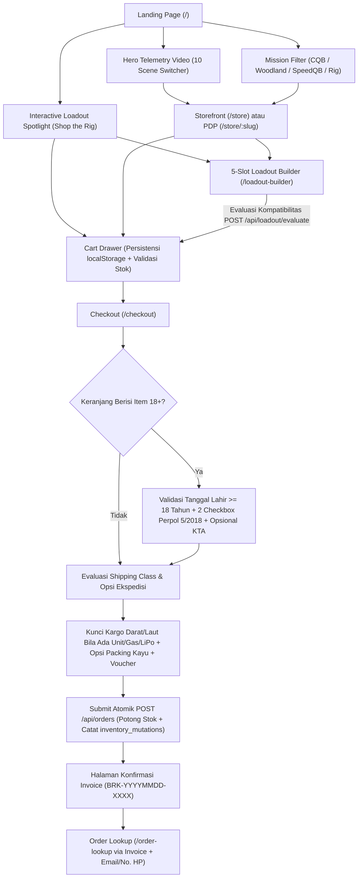
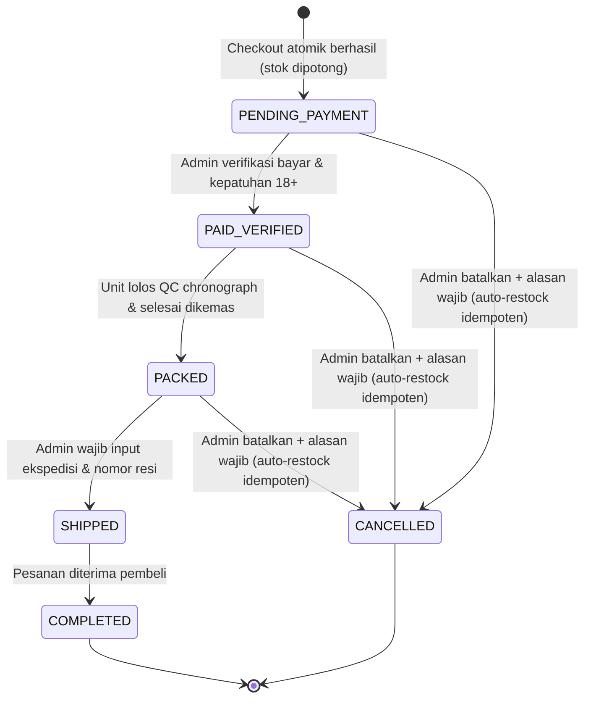

# Spesifikasi Alur Pengguna, Mesin State, Logika Bisnis & Copywriting: Brakasa Tactical

Dokumen ini menjadi kontrak fungsional tunggal bagi tim Backend, Frontend Storefront, dan Admin Engineer **Brakasa Tactical**. Seluruh alur pengguna, transisi status pesanan, aturan deterministik 5-Slot Tactical Loadout Builder untuk 20 SKU katalog awal, rumus kalkulator FPS ke Joule, logika voucher, kalkulasi ongkos kirim kargo darat/laut, serta katalog microcopy bebas slop dirumuskan di sini agar implementasi antar modul berjalan konsisten.

---

## 1. End-to-End User Flows & State Machines

### 1.1 Peta Rute & Kontinuitas Alur Pembeli

Seluruh halaman publik memakai rute nyata tanpa tautan mati (patuh R-24 dan R-26):

| Rute | Peran Utama | Sumber Data API | Transisi Berikutnya |
| :--- | :--- | :--- | :--- |
| `/` | Landing Page: Hero Telemetry Video (10 scene, <= 30 dtk), Mission Filter, Interactive Loadout Spotlight, Field Video Showcase, Panduan Perpol 5/2018 + Kalkulator FPS/Joule, FAQ | `GET /api/bootstrap`, `GET /api/products?featured=1` | `/store`, `/store?mission=...`, `/store/:slug`, `/loadout-builder`, `/compliance` |
| `/store` | Katalog produk dengan pencarian instan (FTS5) dan filter multi-dimensi tersinkron ke URL | `GET /api/products` | `/store/:slug`, buka Cart Drawer |
| `/store/:slug` | Halaman Detail Produk (galeri foto + video demo, tabel spek teknis, isi paket vs kebutuhan tambahan, kompatibilitas, produk pelengkap) | `GET /api/products/:slug` | Tambah ke Cart Drawer, `/loadout-builder?add=:sku` |
| `/loadout-builder` | Perakitan 5-Slot Tactical Loadout Builder + 3 Preset Misi + Evaluasi Kompatibilitas Real-Time | `GET /api/products`, `POST /api/loadout/evaluate` | Masukkan seluruh item tersedia ke Cart Drawer, salin URL build |
| Cart Drawer (global) | Ringkasan keranjang persisten (`localStorage` + validasi stok & harga live) | `GET /api/products` / validasi stok | `/checkout`, `/store` |
| `/checkout` | Checkout kepatuhan 18+ (DOB, deklarasi Perpol 5/2018, opsional KTA), kargo darat/laut otomatis, packing kayu, voucher, dan tampilan Konfirmasi Invoice | `POST /api/vouchers/validate`, `POST /api/orders` | Tampilan Konfirmasi Invoice -> `/order-lookup?invoice=...` |
| `/order-lookup` | Pelacakan pesanan tamu dengan verifikasi 2 bidang (Nomor Invoice + Email/No. HP) | `POST /api/orders/lookup` | Salin nomor resi, cetak ringkasan invoice |
| `/compliance` | Halaman Panduan Regulasi Perpol No. 5/2018, Tabel Klasifikasi Arena, Kalkulator FPS ke Joule, dan 5 FAQ Airsoft Indonesia | Konten statis terkurasi + kalkulator klien | `/store?maxFps=350`, `/store` |

### 1.2 Alur Pembeli End-to-End (Landing Page hingga Order Lookup)



#### Rincian Langkah & Validasi Kritis Pembeli

1. **Landing Page (`/`)**:
   - Hero Video diputar otomatis dalam kondisi senyap (`muted loop playsinline`) setelah poster LCP `` tampil. Pengguna dapat menjeda video (`Jeda Video` / `Putar Video`), mengaktifkan suara, atau mengeklik 10 tombol Telemetry Scene (`SCN-01` hingga `SCN-10`) untuk melompat langsung ke timestamp scene terkait dan membuka filter/unit yang tampil pada scene tersebut.
   - Bila sistem operasi pengguna mengaktifkan `prefers-reduced-motion: reduce`, video otomatis berhenti pada frame poster tajam tanpa memutar fast-cut secara paksa.
   - Seksi Mission Filter mengirim parameter URL langsung ke katalog: `/store?mission=cqb&maxFps=350`, `/store?mission=woodland-recce`, `/store?mission=speedqb&maxFps=330`, dan `/store?mission=rig-protection`.
   - Seksi Interactive Loadout Spotlight menampilkan stok live tiap komponen rig. Pengguna dapat memasukkan satu item langsung ke keranjang atau mengeklik `Muat Rig ke Loadout Builder` agar seluruh SKU pada rig langsung terisi di `/loadout-builder`.

2. **Storefront (`/store`), PDP (`/store/:slug`), dan Loadout Builder (`/loadout-builder`)**:
   - Filter katalog mencakup pencarian kata kunci (debounce 250ms), kategori, misi, platform, propulsi, rentang FPS, status stok, rentang harga IDR, dan toggle `Ada Video Demo`. Seluruh parameter tersinkron di query string agar tautan bisa dibagikan.
   - PDP memisahkan secara tegas daftar **Isi Paket (In The Box)** dari **Kebutuhan Operasional Tambahan** (contoh: unit AEG memerlukan baterai LiPo dan smart balance charger; unit GBBR memerlukan Green Gas dan BB 6mm).
   - Kuantitas yang ditambahkan ke keranjang dibatasi `1 <= qty <= product.stock`. Produk dengan `stock === 0` menonaktifkan tombol beli (`cursor: not-allowed`) dengan label `Stok Sedang Habis`.

3. **Persistent Cart (Cart Drawer)**:
   - Disimpan pada `localStorage` dengan kunci berversi `brakasa_cart_v1` berisi array `{ sku, productId, quantity }`.
   - Setiap kali Cart Drawer atau `/checkout` dibuka, klien menyinkronkan harga terbaru, `stock`, `requires_age_18`, `shipping_class`, dan `weight_grams` terhadap data server agar harga tidak bisa dimanipulasi di sisi browser.
   - Jika stok suatu SKU turun di bawah kuantitas di keranjang, sistem otomatis menurunkan kuantitas ke stok maksimum yang tersisa sambil menampilkan pemberitahuan eksplisit. Jika stok menjadi `0`, tombol lanjut checkout diblokir sampai item tersebut dihapus.

4. **Checkout (`/checkout`)**:
   - **Data Penerima & Alamat**: Nama lengkap (wajib sesuai identitas), email valid, nomor WhatsApp/HP Indonesia (`08...` atau `+62...`, 10 sampai 15 digit), zona pengiriman (`JABODETABEK`, `JAWA`, `SUMATERA_BALI`, `KALIMANTAN_SULAWESI`, `INDONESIA_TIMUR`), kota/kabupaten, kecamatan, kode pos (5 digit), alamat lengkap, dan catatan pengiriman opsional.
   - **Validasi Usia >= 18 Tahun (Kondisional Otomatis)**:
     - Aktif secara otomatis ketika minimal satu item di keranjang memiliki `requires_age_18 = true` (semua replika `BRK-AR-*`, `BRK-SMG-*`, `BRK-SNP-*`, `BRK-PST-*`).
     - Pengguna wajib mengisi **Tanggal Lahir (`buyer_dob`, format ISO `YYYY-MM-DD`)**.
     - Rumus usia eksak di klien dan server (memperhitungkan bulan dan hari lahir terhadap tanggal WIB saat transaksi):
       ```ts
       function calculateExactAge(dobIso: string, now: Date): number {
         const [year, month, day] = dobIso.split('-').map(Number);
         let age = now.getFullYear() - year;
         const monthDiff = (now.getMonth() + 1) - month;
         if (monthDiff < 0 || (monthDiff === 0 && now.getDate() < day)) {
           age -= 1;
         }
         return age;
       }
       ```
     - Jika `age < 18` atau tanggal lahir tidak valid/di masa depan, form memblokir submit dan server mengembalikan `400 Bad Request` (`AGE_UNDER_18`).
   - **Deklarasi Kepatuhan Perpol No. 5 Tahun 2018 & KTA Opsional**:
     - Dua checkbox wajib (keduanya default tidak tercentang):
       1. `age_declaration_accepted`: *"Saya berusia 18 tahun atau lebih dan data identitas yang saya masukkan sesuai kartu identitas resmi."*
       2. `perpol_declaration_accepted`: *"Saya memahami replika airsoft 6mm (<= 2,0 Joule) tunduk pada Perpol No. 5 Tahun 2018, hanya digunakan untuk olahraga menembak atau koleksi resmi, dilarang dibawa di ruang publik, dan wajib dikirim melalui kargo darat/laut."*
     - **Tujuan Penggunaan (Wajib saat 18+ aktif)**: pilih salah satu dari `OLAHRAGA_KLUB` (Olahraga Skirmish / Klub Resmi), `LATIHAN_TARGET` (Latihan Target di Arena Terizin), atau `KOLEKSI_PRIBADI` (Koleksi Pribadi).
     - **Nomor KTA Klub (Opsional)**: input teks bebas terformat untuk Nomor KTA **PERBAKIN / PORGASI / ABU / INNASSOC / FAI** beserta pilihan nama organisasi induk (opsional) untuk dicatat pada order dan mempermudah verifikasi admin.
   - **Pemilihan Ekspedisi Otomatis (`shipping_class`) & Packing Kayu**:
     - Sistem menghitung `effectiveShippingClass` tertinggi di keranjang (`CARGO_GAS > CARGO_REPLICA > CARGO_BATTERY > REGULAR`).
     - Jika keranjang memuat unit replika, Green Gas, atau baterai LiPo, opsi kurir reguler/udara otomatis disembunyikan atau dinonaktifkan dengan keterangan sebabnya; pembeli hanya bisa memilih kargo darat/laut yang diizinkan atau `Ambil di Armory`.
     - Checkbox **Packing Kayu Pelindung** (`wooden_packing`, Rp75.000) muncul untuk pengiriman ekspedisi (direkomendasikan secara visual saat ada unit replika `CARGO_REPLICA` atau gas `CARGO_GAS`; otomatis nonaktif dan Rp0 bila pembeli memilih `Ambil di Armory`).
   - **Penerapan Voucher**: input kode voucher otomatis di-trim dan diubah ke huruf kapital, lalu divalidasi lewat `POST /api/vouchers/validate`.
   - **Pembuatan Pesanan Atomik (`POST /api/orders`)**:
     - Server mengabaikan harga/subtotal dari klien dan menghitung ulang seluruh angka langsung dari tabel `products`, `vouchers`, dan `site_settings`.
     - Dalam satu transaksi SQLite `BEGIN IMMEDIATE ... COMMIT`:
       1. Cek `product.stock >= item.quantity` untuk setiap baris; jika satu saja gagal, rollback seluruh transaksi dan kembalikan `409 Conflict` (`INSUFFICIENT_STOCK`) beserta daftar SKU yang kurang.
       2. Kurangi stok (`UPDATE products SET stock = stock - ? WHERE id = ?`).
       3. Catat baris audit di `inventory_mutations` (`mutation_type = 'ORDER_DEDUCT'`, `delta_qty = -qty`, `stock_before`, `stock_after`, `reference_code = invoice_number`, `actor = 'system:checkout'`).
       4. Simpan record `orders` (status awal `PENDING_PAYMENT`, `stock_restored = 0`) dan seluruh `order_items` (menyimpan snapshot `product_name`, `product_sku`, `unit_price`, `quantity`, `weight_grams`).
       5. Bila voucher dipakai, lakukan guard atomik `UPDATE vouchers SET used_count = used_count + 1 WHERE code = ? AND used_count < usage_limit`; bila `changes === 0`, rollback transaksi dan kembalikan `409 Conflict` (`VOUCHER_QUOTA_EXCEEDED`).
     - Setelah transaksi commit, klien mengosongkan `brakasa_cart_v1` dan langsung menampilkan **Halaman Konfirmasi Invoice** berisi nomor invoice (`BRK-YYYYMMDD-XXXX`), batas waktu pembayaran, instruksi transfer sesuai metode pembayaran terpilih, rincian total, tombol `Salin Nomor Invoice`, tombol `Cetak Ringkasan Invoice`, dan tombol `Pantau Status Pesanan` yang mengarah ke `/order-lookup?invoice=BRK-...`.

5. **Order Lookup (`/order-lookup`)**:
   - Pembeli tamu mengisi **Nomor Invoice** (auto-trim & uppercase) dan **Email atau No. HP** yang dipakai saat checkout.
   - Endpoint `POST /api/orders/lookup` dilindungi rate limiter (maksimal 15 percobaan per IP per 10 menit) dan mencocokkan nomor HP setelah normalisasi format (`+62...` disetarakan dengan `0...`).
   - Jika cocok, tampilkan badge status saat ini, timeline progres 5 tahap (`PENDING_PAYMENT` -> `PAID_VERIFIED` -> `PACKED` -> `SHIPPED` -> `COMPLETED`, atau jalur terminal `CANCELLED`), kotak **Informasi Ekspedisi & Nomor Resi** (aktif saat `SHIPPED`/`COMPLETED` lengkap dengan tombol `Salin Nomor Resi`), manifest produk, rincian biaya, status verifikasi 18+, serta tombol `Cetak Ringkasan Invoice`.

---

### 1.3 Alur Admin & Order State Machine

#### Autentikasi & Proteksi Rute Admin (`/admin/*`)

1. Staf mengakses `/admin/login` dan memasukkan email serta kata sandi.
2. `POST /api/admin/auth/login` memverifikasi hash `scryptSync` dengan `timingSafeEqual` (rate limit maksimal 10 percobaan gagal per IP per 15 menit). Jika gagal, kembalikan `401 Unauthorized` dengan pesan generik tanpa membocorkan apakah email terdaftar.
3. Jika berhasil, server membuat token sesi acak 32 byte, menyimpan hash token + `expires_at` (masa berlaku 24 jam) ke tabel `admin_sessions`, dan mengirim cookie `HttpOnly; SameSite=Lax; Path=/` (ditambah `Secure` di HTTPS produksi).
4. Middleware `requireAdminSession` memeriksa cookie pada seluruh rute `/api/admin/*` (kecuali `/api/admin/auth/login`). Permintaan tanpa sesi sah selalu menerima `401 Unauthorized`, dan UI mengarahkan browser ke `/admin/login`.
5. `POST /api/admin/auth/logout` menghapus sesi di `admin_sessions` dan menimpa cookie dengan `Max-Age=0`.

#### Alur Kerja Harian Admin Operations Center

1. **Dashboard Operasional (`/admin`)**: Membuka langsung pada dua daftar prioritas operasional nyata dari SQLite:
   - **Antrean Pesanan Perlu Tindakan**: pesanan berstatus `PENDING_PAYMENT` (butuh verifikasi bayar & data 18+), `PAID_VERIFIED` (siap masuk QC chronograph & kemas), dan `PACKED` (siap serah kargo & input resi).
   - **Peringatan Stok Kritis**: daftar SKU aktif dengan `stock <= low_stock_threshold` lengkap dengan aksi `Catat Restock Masuk`.
   - Di bawahnya tampil 4 angka ringkasan riil dari query SQL (omzet pesanan terverifikasi/selesai, jumlah antrean aktif, jumlah SKU stok kritis/habis, total SKU aktif & bervideo) serta 10 baris mutasi terbaru dari `inventory_mutations`. Tidak ada angka karangan atau grafik tren palsu.
2. **Pemrosesan Pesanan (`/admin/orders`)**: Admin menyaring berdasarkan tab status, memeriksa rincian pembeli (termasuk usia terhitung dari `buyer_dob`, nomor KTA opsional, tujuan penggunaan, metode kargo, dan opsi packing kayu), lalu memajukan status sesuai state machine.
3. **Manajemen Inventori (`/admin/inventory`)**: Setiap perubahan stok pasca-pembuatan produk wajib melalui aksi `Restock (+)` atau `Penyesuaian Stok (+/-)` dengan alasan tertulis, guard `stock_after >= 0`, dan pencatatan append-only ke `inventory_mutations`.
4. **Manajemen Produk, Voucher & Pengaturan (`/admin/products`, `/admin/vouchers`, `/admin/settings`)**: Pengelolaan CRUD 20+ SKU termasuk `specs_json`, `compatibility_tags_json`, unggah/pilih media foto & video, pengelolaan kode voucher, serta pengaturan Hero Video, 10 timestamp Telemetry Scenes, dan tabel tarif kargo.

#### Order Status State Machine (Deterministic & Idempotent)



#### Matriks Aturan Transisi Status (`PATCH /api/admin/orders/:id/status`)

| Status Asal | Status Tujuan Sah | Field Wajib di Payload | Efek Samping Transaksi Database (`BEGIN IMMEDIATE`) | Transisi Ilegal (HTTP 409) |
| :--- | :--- | :--- | :--- | :--- |
| `PENDING_PAYMENT` | `PAID_VERIFIED` | `note` (opsional) | Update `status = 'PAID_VERIFIED'`, `verified_at = CURRENT_TIMESTAMP`, tulis log status | Langsung ke `PACKED`, `SHIPPED`, `COMPLETED` |
| `PAID_VERIFIED` | `PACKED` | `note` (opsional, mis. hasil uji chrono FPS) | Update `status = 'PACKED'`, `packed_at = CURRENT_TIMESTAMP`, tulis log status | Mundur ke `PENDING_PAYMENT` atau lompat ke `COMPLETED` |
| `PACKED` | `SHIPPED` | `shipping_courier` (wajib non-kosong), `tracking_number` (wajib min. 5 karakter alfanumerik/tanda hubung) | Update `status = 'SHIPPED'`, `shipping_courier`, `tracking_number`, `shipped_at = CURRENT_TIMESTAMP`, tulis log status | Simpan `SHIPPED` tanpa `tracking_number` (tolak `400 Bad Request`) |
| `SHIPPED` | `COMPLETED` | `note` (opsional) | Update `status = 'COMPLETED'`, `completed_at = CURRENT_TIMESTAMP`, tulis log status | Transisi ke `CANCELLED` (barang sudah di ekspedisi) atau mundur |
| `PENDING_PAYMENT`, `PAID_VERIFIED`, `PACKED` | `CANCELLED` | `cancel_reason` (wajib min. 5 karakter) | Guard idempotensi atomik (`WHERE id = ? AND status IN ('PENDING_PAYMENT','PAID_VERIFIED','PACKED') AND stock_restored = 0`): set `status = 'CANCELLED'`, `stock_restored = 1`, `cancel_reason`; tambahkan kembali tiap `order_items.quantity` ke `products.stock`; insert `inventory_mutations` (`mutation_type = 'ORDER_CANCEL_RESTOCK'`, `delta_qty = +qty`, `reference_code = invoice_number`); tulis log status | Pembatalan ulang saat `stock_restored = 1` tidak boleh menambah stok lagi (kembalikan `409 Conflict: ORDER_ALREADY_CANCELLED`) |
| `COMPLETED` atau `CANCELLED` | Tidak ada (Terminal) | N/A | Ditolak secara mutlak oleh server (`409 Conflict: TERMINAL_ORDER_STATUS`) | Semua transisi |

#### Jaminan Idempotensi Pengembalian Stok Pembatalan

Agar klik ganda atau retry jaringan tidak pernah menggandakan stok gudang:
1. Baris `orders` memiliki kolom integer `stock_restored` bernilai awal `0`.
2. Di dalam transaksi `BEGIN IMMEDIATE`, server menjalankan query bersyarat tunggal:
   ```sql
   UPDATE orders
   SET status = 'CANCELLED',
       stock_restored = 1,
       cancel_reason = ?,
       updated_at = CURRENT_TIMESTAMP
   WHERE id = ?
     AND status IN ('PENDING_PAYMENT', 'PAID_VERIFIED', 'PACKED')
     AND stock_restored = 0;
   ```
3. Server memeriksa jumlah baris terdampak (`result.changes`). Hanya bila `result.changes === 1`, server mengiterasi `order_items` untuk mengembalikan stok ke `products` dan mencatat `inventory_mutations`. Jika `result.changes === 0`, transaksi langsung di-rollback dan mengembalikan `409 Conflict` tanpa menyentuh stok.

---

## 2. Aturan Mesin Kompatibilitas 5-Slot Tactical Loadout Builder

Mesin evaluasi kompatibilitas (`POST /api/loadout/evaluate` dan helper murni bersama di TypeScript) menerima pilihan 5 slot, lalu mengembalikan struktur evaluasi deterministik:
- `status`: `'COMPATIBLE'` (0 konflik, 0 peringatan), `'WARNING'` (0 konflik, >= 1 peringatan), atau `'CONFLICT'` (>= 1 konflik teknis).
- `findings[]`: array objek `{ code, severity: 'CONFLICT' | 'WARNING' | 'INFO' | 'COMPATIBLE', slot, title, message, suggestedSkus?: string[] }`.
- `totals`: `{ totalPriceIdr, totalWeightGrams, weightClass, effectiveShippingClass, requiresAge18, fieldRoleBadge, estimatedMaxJoule }`.

### 2.1 Pemetaan Lengkap 20 SKU Katalog Awal ke 5 Slot Loadout

Seluruh 20 SKU dari katalog awal masuk tepat ke satu dari 5 slot tanpa ada SKU yang terlewat. Catatan bobot: 15 SKU memakai bobot tepat dari lembar spesifikasi katalog; 5 SKU tanpa bobot pabrikan eksplisit (`BRK-OPT-003`, `BRK-APP-001`, `BRK-APP-002`, `BRK-CSM-002`, `BRK-CSM-003`) memakai nilai parameter seed terstandar untuk kalkulasi berat loadout dan kargo (server selalu membaca `products.weight_grams`).

| No | SKU | Nama Produk | Slot Loadout | Harga (IDR) | Berat Seed (g) | Propulsi & FPS (0.20g) | Daya / Konektor / MOSFET | Ulir Muzzle & Rail / Mount | Shipping Class & 18+ |
| ---: | :--- | :--- | :--- | ---: | ---: | :--- | :--- | :--- | :--- |
| 1 | `BRK-AR-001` | Tokyo Marui MK18 Mod.1 MWS GBBR | Slot 1: Primary Replica (Single) | Rp16.500.000 | 2.960 | GBBR ZET; 300-325 FPS (~0,90 J) | Green Gas (`BRK-CSM-002`); N/A MOSFET | `14mm CCW`; Top Picatinny 1913 + DD RIS II | `CARGO_REPLICA` / 18+ |
| 2 | `BRK-AR-002` | VFC Avalon Saber Carbine M-LOK AEG | Slot 1: Primary Replica (Single) | Rp7.850.000 | 2.850 | AEG V2 ECS; 370-390 FPS (~1,35 J) | Deans T-Plug; **MOSFET/ETU Ada** (11.1V Ready) | `14mm CCW`; Top Picatinny 1913 + M-LOK | `CARGO_REPLICA` / 18+ |
| 3 | `BRK-AR-003` | CYMA CM.040C AK-74M Stamped Steel AEG | Slot 1: Primary Replica (Single) | Rp4.950.000 | 3.200 | AEG V3 Metal; 400-415 FPS (~1,55 J) | Mini Tamiya; **Non-MOSFET** (7.4V disarankan) | `14mm CCW`; AK Side Dovetail (bukan top Picatinny bawaan) | `CARGO_REPLICA` / 18+ |
| 4 | `BRK-SMG-001` | G&G ARP9 2.0 CQB PDW AEG | Slot 1: Primary Replica (Single) | Rp7.200.000 | 1.960 | AEG V2 ETU; 330-350 FPS (~1,10 J) | Deans T-Plug; **MOSFET/ETU Ada** (11.1V Stick Ready) | `14mm CCW`; Top Picatinny 1913 + M-LOK | `CARGO_REPLICA` / 18+ |
| 5 | `BRK-SNP-001` | Silverback TAC-41 P Bolt-Action Sniper | Slot 1: Primary Replica (Single) | Rp12.400.000 | 2.800 | Spring Bolt-Action; 410-445 FPS (1,60-1,90 J) | Manual Spring (tanpa baterai/gas) | **`M24x1 CW`**; Top Picatinny 1913 + M-LOK | `CARGO_REPLICA` / 18+ |
| 6 | `BRK-PST-001` | Umarex / VFC Glock 17 Gen5 GBB | Slot 2: Sidearm (Single) | Rp3.650.000 | 655 | GBB Pistol; 300-330 FPS (~0,95 J) | Green Gas (`BRK-CSM-002`) | Non-threaded barrel standar; Under-rail Picatinny | `CARGO_REPLICA` / 18+ |
| 7 | `BRK-OPT-001` | Vector Optics Maverick Gen III 1x22 Red Dot | Slot 3: Optic / Aiming (Sub-tipe: Optic) | Rp1.850.000 | 185 | Non-Replica (1x Red Dot 3 MOA) | CR2032 (optik) | MIL-STD-1913 Picatinny (QD Riser + Low) | `REGULAR` / Umum |
| 8 | `BRK-OPT-002` | Vector Optics Forester 1-5x24 SFP LPVO Scope | Slot 3: Optic / Aiming (Sub-tipe: Optic) | Rp3.150.000 | 425 | Non-Replica (1-5x LPVO) | CR2032 (iluminasi reticle) | MIL-STD-1913 Picatinny (30mm Rings) | `REGULAR` / Umum |
| 9 | `BRK-OPT-003` | WADSN AN/PEQ-15 Tactical Laser & Illuminator | Slot 3: Optic / Aiming (Sub-tipe: Aiming Module) | Rp1.250.000 | 165* | Non-Replica (Laser + LED Light) | CR123A | MIL-STD-1913 Picatinny | `REGULAR` / Umum |
| 10 | `BRK-RIG-001` | Pew Tactical FCPC V5 Plate Carrier (Cordura 500D) | Slot 4: Rig & Protection (Carrier) | Rp2.450.000 | 1.150 | Non-Replica (Cordura 500D) | N/A | Laser-Cut MOLLE + SwiftClip/G-Hook Placard | `REGULAR` / Umum |
| 11 | `BRK-RIG-002` | EmersonGear Micro Fight Mk4 Modular Chest Rig | Slot 4: Rig & Protection (Chest Rig / Placard) | Rp1.350.000 | 620 | Non-Replica (Cordura 500D) | N/A | H-Harness / SwiftClip Placard (Triple 5.56 Mag Insert) | `REGULAR` / Umum |
| 12 | `BRK-HLM-001` | FMA FAST Maritime High-Cut Bump Helmet | Slot 4: Rig & Protection (Helmet) | Rp1.150.000 | 680 | Non-Replica (ABS Polymer) | N/A | Side ARC Rails + Aluminum NVG Shroud | `REGULAR` / Umum |
| 13 | `BRK-HLM-002` | Earmor M32 Plus Active Tactical Headset | Slot 4: Rig & Protection (Comms) | Rp1.750.000 | 370 | Non-Replica (NRR 22 dB) | 2x AAA (headset aktif) | Headband / Kompatibel ARC Rail Adapter | `REGULAR` / Umum |
| 14 | `BRK-APP-001` | EmersonGear G3 Combat Shirt & Pants Set | Slot 4: Rig & Protection (Apparel) | Rp2.150.000 | 1.350* | Non-Replica (50/50 NyCo Ripstop) | N/A | Integrated Knee Pads | `REGULAR` / Umum |
| 15 | `BRK-APP-002` | Mechanix Wear M-Pact Tactical Gloves | Slot 4: Rig & Protection (Gloves) | Rp680.000 | 140* | Non-Replica (TPR + D3O) | N/A | Pelindung buku jari & telapak | `REGULAR` / Umum |
| 16 | `BRK-APP-003` | Salomon Forces XA Mid GTX Tactical Boots | Slot 4: Rig & Protection (Boots) | Rp4.950.000 | 1.080 | Non-Replica (GORE-TEX, 540 g/sepatu) | N/A | Contagrip All-Terrain Outsole | `REGULAR` / Umum |
| 17 | `BRK-CSM-001` | BLS Precision 6mm BB 0.28g (1 kg / ~3.570 rds) | Slot 5: Consumables & Muzzle (BB) | Rp185.000 | 1.000 | Non-Replica (5,95mm +/- 0,01mm) | N/A | Kaliber 6mm universal | `REGULAR` / Umum |
| 18 | `BRK-CSM-002` | Puff Dino 12kg Green Gas (600ml) | Slot 5: Consumables & Muzzle (Power: Gas) | Rp165.000 | 420* | Non-Replica (12 kg/cm2 + Silicone) | Green Gas Canister | Nozzle logam untuk mag GBBR/GBB | `CARGO_GAS` / Umum |
| 19 | `BRK-CSM-003` | LiPo 11.1V 1200mAh 25C 3S Stick Battery (Deans) | Slot 5: Consumables & Muzzle (Power: Battery) | Rp245.000 | 95* | Non-Replica (3S 11.1V 25C) | **Deans T-Plug** + JST-XH | Profil Stick (Buffer Tube VFC/ARP9) | `CARGO_BATTERY` / Umum |
| 20 | `BRK-UPG-001` | Acetech Brighter C Compact Tracer Unit | Slot 5: Consumables & Muzzle (Muzzle) | Rp1.050.000 | 32 | Non-Replica (CNC Aluminum) | USB-C internal (35 RPS) | **`14mm CCW`** (+ adapter `11mm CW` pistol) | `REGULAR` / Umum |

*Keterangan tanda bintang (`*`): nilai berat seed operasional yang terstandar di database untuk kalkulasi bobot total loadout dan ongkos kirim.

### 2.2 Matriks Aturan Deterministik Kompatibilitas

Setiap evaluasi menjalankan enam grup aturan berurutan berikut:

#### A. Aturan Daya & Propulsi (`POWER_PROPULSION`)

| Kode Aturan | Kondisi Evaluasi | Level | Pesan ke Pengguna | Saran Aksi / SKU |
| :--- | :--- | :--- | :--- | :--- |
| `GBBR_GREEN_GAS_OK` | Primary `BRK-AR-001` atau Sidearm `BRK-PST-001` dipilih DAN `BRK-CSM-002` dipilih | `COMPATIBLE` | Puff Dino 12kg Green Gas (BRK-CSM-002) cocok dengan sistem katup magasin GBBR/GBB Anda. | Tidak perlu tindakan |
| `MISSING_GREEN_GAS` | Primary `BRK-AR-001` atau Sidearm `BRK-PST-001` dipilih TANPA `BRK-CSM-002` | `WARNING` | Unit Gas Blowback membutuhkan Green Gas agar dapat ditembakkan. Tambahkan Puff Dino 12kg Green Gas (BRK-CSM-002). | Tambah `BRK-CSM-002` |
| `AEG_DEANS_LIPO_OK` | Primary `BRK-AR-002` atau `BRK-SMG-001` dipilih DAN `BRK-CSM-003` dipilih | `COMPATIBLE` | LiPo 11.1V 3S Stick Deans (BRK-CSM-003) cocok langsung dengan konektor Deans, ruang buffer tube, dan MOSFET/ETU bawaan unit. | Ingatkan smart balance charger |
| `MISSING_LIPO_DEANS` | Primary `BRK-AR-002` atau `BRK-SMG-001` dipilih TANPA `BRK-CSM-003` | `WARNING` | Unit AEG dijual tanpa baterai. Tambahkan LiPo 11.1V Stick Deans (BRK-CSM-003) agar siap pakai di lapangan. | Tambah `BRK-CSM-003` |
| `AK74M_CONNECTOR_VOLTAGE_CONFLICT` | Primary `BRK-AR-003` (Mini Tamiya, Non-MOSFET) dipilih BERSAMA `BRK-CSM-003` (11.1V Deans) | `CONFLICT` | Ketidakcocokan konektor dan tegangan: CYMA CM.040C (BRK-AR-003) memakai konektor Mini Tamiya tanpa MOSFET, sedangkan BRK-CSM-003 adalah baterai 11.1V berkonektor Deans. Pemakaian 11.1V tanpa MOSFET mempercepat aus kontak pelatuk; lepas BRK-CSM-003 dan gunakan LiPo 7.4V Mini Tamiya atau upgrade MOSFET + Deans terlebih dahulu. | Hapus `BRK-CSM-003` atau ganti Primary ke `BRK-AR-002` |
| `AK74M_NEEDS_74V_TAMIYA` | Primary `BRK-AR-003` dipilih TANPA baterai di Slot 5 | `INFO` | CYMA CM.040C memerlukan baterai LiPo 7.4V berkonektor Mini Tamiya (tidak termasuk dalam paket unit). | Catatan persiapan baterai |
| `REDUNDANT_LIPO` | `BRK-CSM-003` dipilih padahal tidak ada unit AEG di Slot 1 (`BRK-AR-001`, `BRK-SNP-001`, atau Slot 1 kosong) | `WARNING` | Baterai LiPo 11.1V Deans (BRK-CSM-003) tidak diperlukan karena loadout Anda tidak memiliki unit AEG. | Lepas `BRK-CSM-003` |
| `REDUNDANT_GREEN_GAS` | `BRK-CSM-002` dipilih padahal tidak ada `BRK-AR-001` di Slot 1 maupun `BRK-PST-001` di Slot 2 | `WARNING` | Puff Dino Green Gas (BRK-CSM-002) tidak diperlukan karena tidak ada unit GBBR atau pistol GBB pada loadout Anda. | Lepas `BRK-CSM-002` |

#### B. Aturan Ulir Laras & Muzzle Attachment (`MUZZLE_THREAD`)

| Kode Aturan | Kondisi Evaluasi | Level | Pesan ke Pengguna | Saran Aksi / SKU |
| :--- | :--- | :--- | :--- | :--- |
| `MUZZLE_14CCW_OK` | `BRK-UPG-001` dipilih BERSAMA salah satu dari `BRK-AR-001`, `BRK-AR-002`, `BRK-AR-003`, `BRK-SMG-001` | `COMPATIBLE` | Acetech Brighter C (ulir 14mm CCW) cocok langsung pada outer barrel unit utama setelah flash hider bawaan dilepas. | Gunakan Green Tracer BB untuk efek pijar |
| `MUZZLE_M24_CONFLICT` | `BRK-UPG-001` (14mm CCW) dipilih BERSAMA `BRK-SNP-001` (M24x1 CW) | `CONFLICT` | Ulir laras tidak cocok: Silverback TAC-41 P memakai ulir M24x1 CW, sedangkan Acetech Brighter C (BRK-UPG-001) memakai ulir 14mm CCW. Pemasangan membutuhkan thread adapter M24x1 CW ke 14mm CCW secara terpisah. | Lepas `BRK-UPG-001` |
| `MUZZLE_PISTOL_NON_THREADED` | `BRK-UPG-001` dipilih dengan Slot 1 kosong dan hanya `BRK-PST-001` di Slot 2 | `WARNING` | Glock 17 Gen5 GBB standar memakai outer barrel non-ulir. Pemasangan Acetech Brighter C membutuhkan upgrade threaded outer barrel 11mm CW atau 14mm CCW. | Lepas `BRK-UPG-001` atau tambah Primary 14mm CCW |

#### C. Aturan Mounting Optik & Peran Medan (`OPTIC_RAIL`)

| Kode Aturan | Kondisi Evaluasi | Level | Pesan ke Pengguna | Saran Aksi / SKU |
| :--- | :--- | :--- | :--- | :--- |
| `OPTIC_PICATINNY_OK` | Salah satu dari `BRK-OPT-001`, `BRK-OPT-002`, `BRK-OPT-003` dipilih BERSAMA `BRK-AR-001`, `BRK-AR-002`, `BRK-SMG-001`, atau `BRK-SNP-001` | `COMPATIBLE` | Sistem mounting MIL-STD-1913 Picatinny cocok langsung dengan top rail unit utama Anda. | Tidak perlu tindakan |
| `AK74M_NEEDS_RAIL_ADAPTER` | Salah satu dari `BRK-OPT-001`, `BRK-OPT-002`, `BRK-OPT-003` dipilih BERSAMA `BRK-AR-003` | `WARNING` | CYMA CM.040C memakai dudukan AK side dovetail bawaan. Pemasangan optik atau PEQ-15 Picatinny memerlukan AK side rail mount atau railed dust cover tambahan. | Catatan kebutuhan mount AK |
| `LPVO_ON_CQB_PDW` | `BRK-SMG-001` (ARP9 2.0 CQB) dipilih BERSAMA `BRK-OPT-002` (Forester 1-5x24 LPVO) | `WARNING` | LPVO 1-5x24 (425 g) menambah beban atas pada platform PDW CQB jarak pendek. Red Dot 1x22 (BRK-OPT-001) memberi akuisisi target lebih cepat di ruang sempit. | Ganti ke `BRK-OPT-001` |
| `REDDOT_ONLY_ON_SNIPER` | `BRK-SNP-001` (TAC-41 Sniper) dipilih BERSAMA `BRK-OPT-001` (1x Red Dot) tanpa `BRK-OPT-002` | `WARNING` | Red Dot 1x tanpa pembesaran membatasi akurasi jarak efektif Silverback TAC-41 P. Pertimbangkan Forester 1-5x24 LPVO (BRK-OPT-002). | Ganti ke `BRK-OPT-002` |
| `DUPLICATE_OPTIC` | `BRK-OPT-001` dan `BRK-OPT-002` dipilih bersamaan | `WARNING` | Dua optik bidik utama dipilih bersamaan. Pilih salah satu sesuai jarak main (Red Dot 1x atau LPVO 1-5x). | Lepas salah satu optik |

#### D. Aturan Berat BB & Konsumabel (`BB_MATCH`)

| Kode Aturan | Kondisi Evaluasi | Level | Pesan ke Pengguna | Saran Aksi / SKU |
| :--- | :--- | :--- | :--- | :--- |
| `MISSING_BB` | Ada replika di Slot 1 atau Slot 2 TANPA `BRK-CSM-001` | `WARNING` | Loadout belum menyertakan BB 6mm. Tambahkan BLS Precision 6mm BB 0.28g (BRK-CSM-001) agar unit siap uji lapangan. | Tambah `BRK-CSM-001` |
| `BB_028_OPTIMAL_OUTDOOR` | `BRK-CSM-001` dipilih BERSAMA `BRK-AR-001`, `BRK-AR-002`, atau `BRK-AR-003` | `COMPATIBLE` | BB 0.28g ideal untuk menjaga lintasan lurus pada unit AEG outdoor (> 350 FPS) maupun sistem GBBR. | Tidak perlu tindakan |
| `BB_028_SNIPER_BASELINE` | `BRK-CSM-001` dipilih BERSAMA `BRK-SNP-001` | `INFO` | BB 0.28g layak sebagai batas minimal latihan sniper. Untuk jangkauan maksimum di ruang terbuka berangin, pertimbangkan BB 0.32g hingga 0.40g sesuai batas lapangan. | Catatan tuning hop-up TDC |
| `BB_028_CQB_NOTE` | `BRK-CSM-001` dipilih BERSAMA `BRK-SMG-001` atau hanya `BRK-PST-001` | `INFO` | BB 0.28g aman dan stabil pada unit CQB; FPS terukur lebih rendah sekitar 15% dibanding 0.20g dengan energi Joule setara. | Tidak perlu tindakan |
| `TRACER_GLOW_BB_REMINDER` | `BRK-UPG-001` dipilih BERSAMA `BRK-CSM-001` | `INFO` | BLS 0.28g standar dapat melewati Acetech Brighter C tanpa kendala, tetapi efek nyala pijar membutuhkan Green Tracer BB 6mm. | Catatan konsumabel tracer |

#### E. Aturan MED Lapangan & Kepatuhan Regulasi (`FIELD_MED_COMPLIANCE`)

| Kode Aturan | Kondisi Evaluasi | Level | Pesan ke Pengguna | Saran Aksi / SKU |
| :--- | :--- | :--- | :--- | :--- |
| `MED_OVER_400_NO_SIDEARM` | `primary.fps_max > 400` (`BRK-AR-003` 415 FPS atau `BRK-SNP-001` 445 FPS) DAN Slot 2 kosong | `WARNING` | Unit utama melebihi 400 FPS sehingga tunduk pada batas jarak aman tembak (MED) 15 sampai 25 meter. Tambahkan Sidearm CQB <= 350 FPS seperti Glock 17 Gen5 GBB (BRK-PST-001) untuk jarak dekat. | Tambah `BRK-PST-001` |
| `MED_OVER_400_COVERED` | `primary.fps_max > 400` DAN `BRK-PST-001` (300-330 FPS) terpasang di Slot 2 | `COMPATIBLE` | Transisi jarak dekat terlindungi oleh Glock 17 Gen5 GBB (300-330 FPS, legal CQB). | Pastikan `BRK-CSM-002` tersedia |
| `PERPOL_JOULE_COMPLIANT` | Setiap konfigurasi dengan unit katalog awal (`max <= 1.90 J`) | `INFO` | Estimasi energi kinetik unit terpilih berada di bawah batas maksimal 2,0 Joule sesuai Perpol No. 5 Tahun 2018. Wajib gunakan pelindung mata full-seal ANSI Z87.1+ di zona bermain. | Patuh regulasi RI |

#### F. Aturan Modularitas Rig & Proteksi (`RIG_MODULARITY`)

| Kode Aturan | Kondisi Evaluasi | Level | Pesan ke Pengguna | Saran Aksi / SKU |
| :--- | :--- | :--- | :--- | :--- |
| `FCPC_PLACARD_MATCH` | `BRK-RIG-001` dan `BRK-RIG-002` dipilih bersamaan | `COMPATIBLE` | Micro Fight Mk4 (BRK-RIG-002) dapat dipasang langsung sebagai front placard SwiftClip/Velcro pada FCPC V5 Plate Carrier (BRK-RIG-001). | Tidak perlu tindakan |
| `HELMET_COMMS_MATCH` | `BRK-HLM-001` dan `BRK-HLM-002` dipilih bersamaan | `COMPATIBLE` | Earmor M32 Plus (BRK-HLM-002) dapat dipadukan dengan FAST Maritime Helmet (BRK-HLM-001) memakai headband di bawah cangkang atau adapter side ARC rail. | Tidak perlu tindakan |
| `PLACARD_556_INSERT_NOTE` | `BRK-RIG-002` (Triple 5.56 Insert) dipilih BERSAMA `BRK-SMG-001` (9mm), `BRK-AR-003` (AK-74), atau `BRK-SNP-001` (Bolt-Action) | `WARNING` | Insert bawaan Micro Fight Mk4 berformat triple 5.56 (M4/MK18). Untuk magasin ARP9, AK-74, atau TAC-41, ganti insert bagian dalam dengan pouch yang sesuai ukuran magasin. | Catatan insert pouch |

#### Klasifikasi Total Berat Loadout
- `Ultralight (< 4.000 g)`: cocok untuk CQB cepat dan manuver ruang sempit.
- `Balanced Tactical (4.000 g - 6.500 g)`: keseimbangan proteksi dan mobilitas untuk skirmish harian.
- `Heavy Direct Action (> 6.500 g)`: kit lengkap dua unit atau helm, comms, carrier, dan pakaian tempur penuh.

---

### 2.3 Tiga Preset Misi Siap Pakai (Zero Conflict, Berbasis 20 SKU Nyata)

Pengguna dapat memuat salah satu preset berikut lewat satu klik di `/loadout-builder`. Seluruh preset di bawah tervalidasi menghasilkan **0 Konflik**.

#### Preset 1: CQB Speed Breacher (`preset=cqb-speed-breacher`)
Dirancang untuk arena CQB indoor dengan batas `<= 350 FPS`, respons pelatuk cepat dari ETU/MOSFET, dan bobot terukur tanpa perlu sidearm wajib.

| Slot | SKU | Nama Produk | Harga (IDR) | Berat (g) |
| :--- | :--- | :--- | ---: | ---: |
| 1. Primary Replica | `BRK-SMG-001` | G&G ARP9 2.0 CQB PDW AEG | Rp7.200.000 | 1.960 |
| 2. Sidearm | (Kosong, opsional) | Tidak diwajibkan karena Primary 330-350 FPS CQB legal | Rp0 | 0 |
| 3. Optic / Aiming | `BRK-OPT-001` | Vector Optics Maverick Gen III 1x22 Red Dot | Rp1.850.000 | 185 |
| 4. Rig & Protection | `BRK-RIG-001`, `BRK-APP-002` | Pew Tactical FCPC V5 Plate Carrier + Mechanix Wear M-Pact Gloves | Rp3.130.000 | 1.290 |
| 5. Consumables & Muzzle | `BRK-CSM-003`, `BRK-UPG-001`, `BRK-CSM-001` | LiPo 11.1V Deans + Acetech Brighter C Tracer + BLS 0.28g BB (1 kg) | Rp1.480.000 | 1.127 |
| **Total Preset 1** | **7 SKU** | **Status: 0 Konflik / CQB Legal (<= 350 FPS) / Kargo Darat (`CARGO_REPLICA`)** | **Rp13.660.000** | **4.562 g (4,56 kg)** |

#### Preset 2: Woodland Recce Marksman (`preset=woodland-recce-marksman`)
Dirancang untuk peran pengintaian dan jarak menengah-jauh di medan terbuka. Menyertakan Sidearm CQB wajib guna memenuhi MED lapangan unit `> 400 FPS` dan menghindari konflik ulir `M24x1 CW`.

| Slot | SKU | Nama Produk | Harga (IDR) | Berat (g) |
| :--- | :--- | :--- | ---: | ---: |
| 1. Primary Replica | `BRK-SNP-001` | Silverback TAC-41 P Bolt-Action Sniper | Rp12.400.000 | 2.800 |
| 2. Sidearm | `BRK-PST-001` | Umarex / VFC Glock 17 Gen5 GBB | Rp3.650.000 | 655 |
| 3. Optic / Aiming | `BRK-OPT-002` | Vector Optics Forester 1-5x24 SFP LPVO Scope | Rp3.150.000 | 425 |
| 4. Rig & Protection | `BRK-APP-001`, `BRK-APP-003`, `BRK-HLM-002` | G3 Combat Set + Salomon Forces XA Mid GTX + Earmor M32 Plus Headset | Rp8.850.000 | 2.800 |
| 5. Consumables & Muzzle | `BRK-CSM-001`, `BRK-CSM-002` | BLS 0.28g BB (1 kg) + Puff Dino 12kg Green Gas (untuk Sidearm GBB) | Rp350.000 | 1.420 |
| **Total Preset 2** | **8 SKU** | **Status: 0 Konflik / Sniper + Backup CQB / Kargo Gas (`CARGO_GAS`)** | **Rp28.400.000** | **8.100 g (8,10 kg)** |

#### Preset 3: Gas Blowback Realism Kit (`preset=gbb-realism-kit`)
Dirancang bagi pemain milsim dan kolektor yang menginginkan recoil mekanis penuh pada rifle dan pistol dengan satu sumber gas seragam, sistem placard 5.56 modular, serta integrasi helm dan comms aktif.

| Slot | SKU | Nama Produk | Harga (IDR) | Berat (g) |
| :--- | :--- | :--- | ---: | ---: |
| 1. Primary Replica | `BRK-AR-001` | Tokyo Marui MK18 Mod.1 MWS GBBR | Rp16.500.000 | 2.960 |
| 2. Sidearm | `BRK-PST-001` | Umarex / VFC Glock 17 Gen5 GBB | Rp3.650.000 | 655 |
| 3. Optic / Aiming | `BRK-OPT-001`, `BRK-OPT-003` | Maverick Gen III 1x22 Red Dot + WADSN AN/PEQ-15 Laser & Illuminator | Rp3.100.000 | 350 |
| 4. Rig & Protection | `BRK-RIG-001`, `BRK-RIG-002`, `BRK-HLM-001`, `BRK-HLM-002` | FCPC V5 Plate Carrier + Micro Fight Mk4 Placard 5.56 + FAST Maritime Helmet + Earmor M32 Plus | Rp6.700.000 | 2.820 |
| 5. Consumables & Muzzle | `BRK-CSM-002`, `BRK-CSM-001` | Puff Dino 12kg Green Gas + BLS 0.28g BB (1 kg) | Rp350.000 | 1.420 |
| **Total Preset 3** | **10 SKU** | **Status: 0 Konflik / CQB & Milsim Legal / Kargo Gas (`CARGO_GAS`)** | **Rp30.300.000** | **8.205 g (8,21 kg)** |

---

## 3. Aturan Voucher, Ongkos Kirim & Kalkulator FPS ke Joule

### 3.1 Kalkulator FPS ke Joule & Indikator Regulasi RI

#### Rumus Matematis Eksak

```ts
// Input: bbWeightGrams (0.12 - 0.50 g), fps (50 - 800)
const velocityMetersPerSecond = fps * 0.3048;
const massKilograms = bbWeightGrams / 1000;
const joule = 0.5 * massKilograms * (velocityMetersPerSecond ** 2);

// Konversi balik ke FPS ekuivalen pada BB uji standar 0.20g
const equivalentFpsAt020g = Math.sqrt(joule / (0.5 * 0.0002)) / 0.3048;
```

Persamaan eksplisit:
`J = 0.5 * (berat_gram / 1000) * (FPS * 0.3048)^2`

#### Tabel Verifikasi Nilai Acuan (Presisi 2 Desimal)

| Input FPS | Berat BB | Kecepatan (m/s) | Energi Kinetik (J) | Ekuivalen @ 0.20g | Klasifikasi Arena | Status Perpol 5/2018 |
| ---: | ---: | ---: | ---: | ---: | :--- | :--- |
| 300 FPS | 0,20 g | 91,44 m/s | 0,84 J | 300 FPS | CQB Indoor Ketat / Sidearm | Patuh (<= 2,0 J) |
| 330 FPS | 0,20 g | 100,58 m/s | 1,01 J | 330 FPS | SpeedQB / CQB Umum | Patuh (<= 2,0 J) |
| 350 FPS | 0,20 g | 106,68 m/s | 1,14 J | 350 FPS | Batas Atas CQB (`<= 350 FPS @ 0.20g`) | Patuh (<= 2,0 J) |
| 400 FPS | 0,20 g | 121,92 m/s | 1,49 J | 400 FPS | Assault Outdoor Standar (MED 5-10 m) | Patuh (<= 2,0 J) |
| 420 FPS | 0,20 g | 128,02 m/s | 1,64 J | 420 FPS | Batas Atas Assault Outdoor (`<= 420 FPS`) | Patuh (<= 2,0 J) |
| 450 FPS | 0,20 g | 137,16 m/s | 1,88 J | 450 FPS | Bolt Sniper / DMR (`<= 450 FPS`, MED 15-25 m) | Patuh (<= 2,0 J) |
| 463 FPS | 0,20 g | 141,12 m/s | 1,99 J | 463 FPS | Batas Maksimal Regulasi RI | Patuh (<= 2,0 J) |
| 350 FPS | 0,28 g | 106,68 m/s | 1,59 J | 414 FPS | Assault Outdoor (Waspada: terlalu tinggi untuk CQB) | Patuh (<= 2,0 J) |
| 392 FPS | 0,28 g | 119,48 m/s | 2,00 J | 464 FPS | Ambang Maksimal Legal (`2,00 J`) | Batas Maksimal Legal |
| 480 FPS | 0,20 g | 146,30 m/s | 2,14 J | 480 FPS | **Dilarang di Arena Airsoft** | **Melebihi Batas 2,0 J** |

#### Aturan Klasifikasi & Pesan Hasil Kalkulator
- `joule <= 1.14` (`<= 350 FPS @ 0.20g`): label `CQB Legal (<= 350 FPS @ 0.20g)`, MED `0 - 3 meter`, indikator aman regulasi RI.
- `1.14 < joule <= 1.64` (`351 - 420 FPS @ 0.20g`): label `Assault Outdoor (<= 420 FPS @ 0.20g)`, MED `5 - 10 meter` (tambahkan catatan wajib sidearm bila `> 400 FPS` di sebagian arena), indikator aman regulasi RI.
- `1.64 < joule <= 2.00` (`421 - 463 FPS @ 0.20g`, acuan umum Bolt Sniper `<= 450 FPS / <= 1,88 J`): label `DMR / Bolt-Action Sniper (<= 2,00 J)`, MED `15 - 25 meter`, wajib membawa Sidearm CQB, indikator aman regulasi RI.
- `joule > 2.00`: label `Melampaui Batas Legal RI (> 2,00 Joule)`, tampilkan status peringatan merah agar pengguna menurunkan pegas atau setelan gas sebelum membawa unit ke arena.
- Validasi input kalkulator: tolak nilai FPS `< 50` atau `> 800` dan berat BB `< 0,12 g` atau `> 0,50 g` dengan pesan galat langsung di bawah input terkait.

---

### 3.2 Aturan 3 Kode Voucher Awal (Siap Uji End-to-End)

Seed database awal memuat 3 kode voucher aktif yang dapat diuji langsung di `/checkout` maupun dikelola di `/admin/vouchers`:

| Kode Voucher | Tipe Diskon | Nilai Diskon | Plafon Diskon | Minimum Subtotal | Kuota Awal | Cakupan & Aturan Khusus |
| :--- | :--- | ---: | ---: | ---: | ---: | :--- |
| `BRAKASA10` | `PERCENT` | 10% | Rp500.000 | Rp2.000.000 | 100 | Diskon 10% dari subtotal item (maksimal Rp500.000). Contoh uji: subtotal Rp4.950.000 mendapat potongan Rp495.000; subtotal Rp7.850.000 mendapat potongan maksimal Rp500.000. |
| `CQBREADY` | `FIXED` | Rp250.000 | Rp250.000 | Rp3.500.000 | 50 | Potongan langsung Rp250.000 dari subtotal item untuk perakitan kit CQB atau pembelian minimal Rp3.500.000. |
| `KARGOFREE` | `SHIPPING_FIXED` (atau `FIXED` terikat ongkir) | Rp150.000 | `min(Rp150.000, shipping_cost)` | Rp5.000.000 | 75 | Subsidi ongkos kirim kargo darat/laut hingga Rp150.000 untuk transaksi minimal Rp5.000.000. Tidak berlaku jika metode pengiriman `Ambil di Armory` (`shipping_cost === 0`). |

#### Aturan Validasi Server (`POST /api/vouchers/validate`)
1. Normalisasi kode: `code.trim().toUpperCase()`.
2. Cek keberadaan kode -> bila tidak ada: `404` (`Kode voucher tidak ditemukan. Periksa kembali ejaan kode Anda.`).
3. Cek `is_active === 1` -> bila nonaktif: `400` (`Voucher ini sedang tidak aktif.`).
4. Cek rentang waktu (`starts_at <= NOW <= expires_at`) -> bila belum mulai atau kadaluwarsa: `400` (`Masa berlaku voucher ini telah berakhir.` / `Voucher ini belum memasuki periode aktif.`).
5. Cek kuota (`used_count < usage_limit`) -> bila habis: `400` (`Kuota penggunaan voucher ini sudah habis.`).
6. Cek `subtotal >= min_order_amount` -> bila kurang: `400` (`Minimum belanja untuk voucher [CODE] adalah Rp[min]. Tambahkan Rp[selisih] lagi agar voucher dapat digunakan.`).
7. Khusus `KARGOFREE`: jika `shipping_cost === 0` (Ambil di Armory), kembalikan `400` (`Voucher KARGOFREE hanya berlaku untuk pengiriman ekspedisi berbayar.`).
8. Pembatasan: maksimal 1 kode voucher per pesanan; `grand_total` tidak boleh bernilai negatif (`Math.max(0, subtotal - discount + shipping_cost + wooden_packing_cost)`).

---

### 3.3 Aturan Ongkos Kirim & Kelas Pengiriman Kargo Darat/Laut

#### Prioritas Kelas Pengiriman Keranjang
Evaluasi mengambil tingkat paling ketat dari seluruh SKU dalam keranjang:
`CARGO_GAS (4)` > `CARGO_REPLICA (3)` > `CARGO_BATTERY (2)` > `REGULAR (1)`.

| `effectiveShippingClass` | SKU Pemicu | Kurir yang Diizinkan | Kurir yang Diblokir Otomatis | Opsi Packing Kayu |
| :--- | :--- | :--- | :--- | :--- |
| `REGULAR` | Hanya optik, rig, helm, comms, apparel, sepatu, BB, tracer | Kurir Reguler (JNE Reg / SiCepat Reg), JNE Trucking (JTR), Ambil di Armory | Tidak ada | Opsional (Rp75.000) |
| `CARGO_BATTERY` | Mengandung `BRK-CSM-003` (LiPo) tanpa unit/gas | JNE Trucking (JTR), Indah Cargo Darat, Ambil di Armory | Semua layanan udara / reguler kilat | Opsional (Rp75.000) |
| `CARGO_REPLICA` | Mengandung unit replika (`BRK-AR-*`, `BRK-SMG-*`, `BRK-SNP-*`, `BRK-PST-*`) tanpa gas | JNE Trucking (JTR), Indah Cargo Darat, Dakota Cargo Darat, Ambil di Armory | Semua layanan udara / reguler | Direkomendasikan aktif (Rp75.000; Rp0 bila Ambil di Armory) |
| `CARGO_GAS` | Mengandung `BRK-CSM-002` (Green Gas bertekanan) | Kargo Khusus Darat/Laut Gas & Replika, Ambil di Armory | Semua layanan udara, reguler, dan kargo standar non-gas | Opsional / direkomendasikan bila disertai unit (Rp75.000) |

#### Formula & Tabel Tarif Deterministik (Default `site_settings`, Dapat Diedit Admin)

Berat terhitung dalam kg:
- Kurir Reguler: `chargeableKg = Math.max(1, Math.ceil(totalWeightGrams / 1000))`
- Kargo Darat/Laut (JTR / Indah / Dakota / Kargo Khusus Gas): tarif dasar mencakup hingga `5 kg` pertama (`baseRate`), kelebihan per kg berikutnya dikenai `extraPerKg`.

| Zona Pengiriman | Reguler (per kg) | Kargo Darat JTR/Indah (Base <= 5 kg + per kg tambahan) | Kargo Khusus Gas & Replika (Base <= 5 kg + per kg tambahan) | Estimasi Hari Kerja |
| :--- | ---: | ---: | ---: | :--- |
| `JABODETABEK` | Rp15.000 | Rp45.000 (+ Rp6.000/kg) | Rp55.000 (+ Rp8.000/kg) | Reguler 1-2 hari; Kargo 2-3 hari |
| `JAWA` | Rp22.000 | Rp65.000 (+ Rp8.000/kg) | Rp80.000 (+ Rp10.000/kg) | Reguler 2-3 hari; Kargo 3-5 hari |
| `SUMATERA_BALI` | Rp35.000 | Rp110.000 (+ Rp14.000/kg) | Rp135.000 (+ Rp18.000/kg) | Reguler 3-5 hari; Kargo 5-8 hari |
| `KALIMANTAN_SULAWESI` | Rp48.000 | Rp150.000 (+ Rp20.000/kg) | Rp185.000 (+ Rp24.000/kg) | Reguler 4-6 hari; Kargo 7-12 hari |
| `INDONESIA_TIMUR` | Rp65.000 | Rp210.000 (+ Rp28.000/kg) | Rp250.000 (+ Rp32.000/kg) | Reguler 5-8 hari; Kargo 10-16 hari |
| `AMBIL_DI_ARMORY` | Rp0 | Rp0 | Rp0 | Siap ambil setelah status `PACKED` |

Biaya Packing Kayu default: `Rp75.000` (disimpan di `site_settings.wooden_packing_fee`).

---

## 4. Katalog Microcopy & UI States Lengkap (Anti-AI-Slop Compliant)

Seluruh teks di bawah mematuhi aturan **R-02** (tanpa em dash dan tanpa double hyphen pengganti dash), **R-15** (CTA spesifik aksi), **R-16** (tanpa buzzword AI seperti "revolusioner", "seamless", "next-gen", "ultimate"), **R-17 & R-18** (nol statistik palsu, nol testimoni fiktif), **R-27** (tiga state lengkap untuk tiap tampilan data), **R-28** (FAQ spesifik domain), dan **R-38** (konten nyata atau placeholder eksplisit).

Suara merek Brakasa Tactical: **lugas, teknis, terukur, dan bertanggung jawab**, ditulis dengan sudut pandang teknisi armory olahraga airsoft Indonesia.

### 4.1 Headline, Subheadline & Label CTA Spesifik per Halaman

| Area / Seksi | Headline | Subheadline / Deskripsi Pendukung | Label CTA (Patuh R-15) |
| :--- | :--- | :--- | :--- |
| **Landing: Hero Video** | Perlengkapan Airsoft dan Taktis dengan Data Teknis Terukur | Replika AEG, GBBR, sniper, optik, dan sistem plate carrier yang dilengkapi data FPS, kompatibilitas daya, serta standar kepatuhan olahraga airsoft 18+ Indonesia. | Primer: `Lihat Katalog Unit` / Sekunder: `Rakit Loadout 5 Slot` / Kontrol Video: `Jeda Video`, `Putar Video`, `Aktifkan Suara`, `Senyapkan Suara` |
| **Landing: Mission Filter** | Pilih Perlengkapan Berdasarkan Medan Main | Saring unit dan gear sesuai batas FPS arena indoor, woodland terbuka, atau kebutuhan proteksi beban. | `Buka Filter CQB`, `Lihat Unit Woodland`, `Buka Katalog SpeedQB`, `Lihat Rig & Proteksi` |
| **Landing: Loadout Spotlight** | Inspeksi Konfigurasi Rig Lapangan | Pilih titik komponen pada rig untuk memeriksa spesifikasi material, ketersediaan stok langsung, dan kecocokan platform. | `Lihat Detail Produk`, `Tambah ke Keranjang`, `Muat Rig ke Loadout Builder`, `Masukkan Item Tersedia ke Keranjang` |
| **Landing: Field Video Showcase** | Uji Mekanisme dalam Video Nyata | Tonton detail gerak bolt, bahan Cordura 500D, dan optik langsung dari unit di katalog aktif. | `Tonton Video Demo`, `Lihat Semua Produk Bervideo` |
| **Landing: Kepatuhan & Kalkulator** | Kepatuhan Perpol No. 5 Tahun 2018 dan Konversi FPS ke Joule | Setiap replika olahraga 6mm dibatasi maksimal 2,0 Joule, dilengkapi penanda orange tip, dan dijual khusus pembeli berusia 18 tahun ke atas. | `Hitung Energi Joule`, `Buka Panduan Kepatuhan Lengkap`, `Cari Unit CQB <= 350 FPS` |
| **Storefront (`/store`)** | Katalog Armory Brakasa Tactical | Saring 20 SKU berdasarkan propulsi, platform, rentang FPS, ketersediaan stok, dan ketersediaan video demo. | `Terapkan Filter`, `Reset Semua Filter`, `Lihat Spesifikasi`, `Tambah ke Keranjang`, `Stok Sedang Habis` |
| **PDP (`/store/:slug`)** | `[Nama Produk dari Database]` | `[Ringkasan 1 kalimat teknis dari short_description]` | `Tambah ke Keranjang`, `Pasang di Loadout Builder`, `Putar Video Demo` |
| **Loadout Builder (`/loadout-builder`)** | Perakitan Loadout Taktis 5 Slot | Padukan replika utama, sidearm, optik, rig, dan konsumabel dengan pemeriksaan kecocokan konektor baterai, ulir laras, serta MED lapangan secara otomatis. | `Terapkan Preset Misi`, `Masukkan Loadout ke Keranjang`, `Salin Tautan Konfigurasi`, `Kosongkan Semua Slot` |
| **Checkout (`/checkout`)** | Penyelesaian Pesanan dan Verifikasi Kepatuhan | Lengkapi alamat kargo darat, verifikasi usia 18+ untuk unit replika, dan periksa rincian total sebelum menerbitkan invoice. | `Terapkan Voucher`, `Hapus Voucher`, `Buat Pesanan & Terbitkan Invoice` |
| **Konfirmasi Invoice** | Invoice `[BRK-YYYYMMDD-XXXX]` Berhasil Diterbitkan | Stok produk telah dipesan untuk transaksi Anda. Selesaikan pembayaran sesuai nominal tepat agar tim admin segera memverifikasi pesanan. | `Salin Nomor Invoice`, `Pantau Status Pesanan`, `Cetak Ringkasan Invoice`, `Kembali ke Katalog` |
| **Order Lookup (`/order-lookup`)** | Periksa Status Pesanan | Masukkan nomor invoice beserta email atau nomor HP saat checkout untuk melihat tahap verifikasi, hasil QC, dan nomor resi ekspedisi. | `Periksa Status Pesanan`, `Salin Nomor Resi`, `Cetak Ringkasan Invoice` |
| **Admin Login (`/admin/login`)** | Masuk ke Panel Operasional Brakasa Tactical | Akses terbatas untuk staf operasional armory guna memverifikasi pesanan, mengatur stok, dan memperbarui katalog. | `Masuk ke Panel Admin` |
| **Admin Operations (`/admin/*`)** | Panel Operasional Armory | Antrean pesanan aktif, peringatan stok kritis, dan ringkasan angka langsung dari basis data transaksi. | `Verifikasi Pembayaran`, `Tandai Sedang Dikemas`, `Simpan Resi & Kirim`, `Tandai Pesanan Selesai`, `Batalkan & Kembalikan Stok`, `Catat Restock Masuk`, `Simpan Penyesuaian Stok` |

#### Daftar Teks Terlarang (Audit Copywriting)
- CTA terlarang: `Get Started`, `Learn More`, `Explore`, `Discover`, `Try Now`, `Mulai Sekarang`, `Jelajahi Sekarang`, `Pelajari Lebih Lanjut`.
- Kata terlarang: `revolusioner`, `seamless`, `next-gen`, `next generation`, `ultimate`, `cutting-edge`, `game-changer`, `effortless`, `solusi all-in-one`, `dipercaya ribuan pelanggan`, `nomor satu di Indonesia`.
- Tanda baca terlarang: karakter em dash (U+2014), en dash sebagai jeda kalimat, dan double hyphen sebagai pengganti dash.
- Placeholder jujur untuk kontak toko: seluruh nomor WhatsApp, alamat gudang, dan jam operasional pada footer maupun instruksi transfer wajib dirender dari tabel `site_settings` (bukan nomor karangan hardcode).

---

### 4.2 Matriks UI States Lengkap: Empty, Loading & Error (Patuh R-27)

Setiap tampilan data di bawah wajib mengimplementasikan ketiga state dengan bahasa manusiawi yang menjelaskan situasi nyata dan langkah lanjutan.

| Tampilan Data | Empty State | Loading State | Error State |
| :--- | :--- | :--- | :--- |
| **1. Storefront: Filter Kosong / Pencarian Nihil (`/store`)** | **Judul:** Tidak ada produk yang cocok dengan filter ini.<br>**Teks:** Kombinasi kata kunci, rentang FPS, atau status stok saat ini tidak menghasilkan unit yang sesuai.<br>**CTA:** `Reset Semua Filter` | Skeleton 6 kartu katalog dengan rasio tetap 16:9 + label screen reader `Memuat daftar produk katalog...` | **Judul:** Gagal memuat katalog produk.<br>**Teks:** Server katalog tidak merespons permintaan saat ini. Periksa koneksi internet Anda lalu muat ulang daftar produk.<br>**CTA:** `Muat Ulang Katalog` |
| **2. Detail Produk (`/store/:slug`)** | **Judul:** Produk tidak ditemukan di katalog aktif.<br>**Teks:** SKU mungkin sudah diarsipkan atau tautan yang Anda buka tidak lengkap.<br>**CTA:** `Kembali ke Katalog Produk` | Layout split 65/35 dengan blok rasio 16:9 dan baris tabel spek + label `Memuat spesifikasi produk...` | **Judul:** Gagal mengambil detail spesifikasi produk.<br>**Teks:** Terjadi gangguan saat memuat data unit ini dari server.<br>**CTA:** `Coba Muat Ulang Halaman` |
| **3. Keranjang Belanja (Cart Drawer & `/checkout` saat kosong)** | **Judul:** Keranjang belanja masih kosong.<br>**Teks:** Tambahkan unit, optik, atau perlengkapan lapangan dari katalog maupun Loadout Builder untuk menghitung ongkos kirim kargo.<br>**CTA:** `Lihat Katalog Unit` dan `Buka Loadout Builder` | Label `Menyinkronkan stok dan harga terbaru...` dengan tombol checkout terkunci sementara (`disabled`) | **Judul:** Gagal memverifikasi stok keranjang.<br>**Teks:** Sistem belum dapat memastikan stok terbaru untuk item di keranjang Anda. Muat ulang sebelum melanjutkan pembayaran.<br>**CTA:** `Periksa Ulang Stok` |
| **4. Loadout Builder: Belum Ada Slot Dipilih (`/loadout-builder`)** | **Judul:** Belum ada komponen pada loadout Anda.<br>**Teks:** Pilih unit utama pada Slot 1 untuk memulai pemeriksaan kompatibilitas daya, ulir laras, dan MED, atau muat salah satu dari 3 preset misi di atas.<br>**CTA:** `Muat Preset CQB Speed Breacher` | Indikator di panel manifest: `Mengevaluasi kecocokan konektor, ulir laras, dan total bobot...` | **Judul:** Evaluasi kompatibilitas gagal dijalankan.<br>**Teks:** Permintaan pemeriksaan loadout tidak tersambung ke server. Pilihan slot Anda tetap tersimpan.<br>**CTA:** `Evaluasi Ulang Loadout` |
| **5. Order Lookup (`/order-lookup`)** | **Status awal sebelum cari:** Masukkan nomor invoice (contoh format `BRK-YYYYMMDD-XXXX`) dan email atau nomor HP yang digunakan saat checkout.<br>**Status tidak ditemukan:** **Judul:** Pesanan tidak ditemukan.<br>**Teks:** Periksa kembali nomor invoice dan pastikan email atau nomor HP sama persis dengan data saat pemesanan.<br>**CTA:** `Periksa Ulang Data Pencarian` | Tombol berubah menjadi `Mencari data pesanan...` (nonaktif sementara) dengan indikator progres | **Judul:** Layanan pelacakan pesanan sedang terganggu.<br>**Teks:** Permintaan tidak dapat diproses saat ini (atau batas pencarian sementara tercapai). Tunggu beberapa saat lalu ulangi.<br>**CTA:** `Coba Cari Lagi` |
| **6. Admin: Belum Ada Pesanan (`/admin` & `/admin/orders`)** | **Judul (Dashboard):** Tidak ada pesanan yang menunggu tindakan.<br>**Teks:** Seluruh pesanan masuk telah diverifikasi atau belum ada transaksi baru dari storefront.<br>**Judul (Filter Status):** Tidak ada pesanan pada status `[Nama Status]`.<br>**CTA:** `Tampilkan Semua Pesanan` | Skeleton baris tabel operasional dengan label `Memuat antrean pesanan dari basis data...` | **Judul:** Gagal memuat daftar pesanan admin.<br>**Teks:** Koneksi ke endpoint pesanan terputus atau sesi admin telah berakhir.<br>**CTA:** `Muat Ulang Antrean` (atau arahkan ke `/admin/login` bila HTTP 401) |
| **7. Admin: Stok Aman (`/admin` & `/admin/inventory`)** | **Judul (Widget Peringatan Stok):** Seluruh stok SKU aktif berada di atas ambang kritis.<br>**Teks:** Tidak ada produk dengan stok menipis atau habis saat ini.<br>**CTA:** `Lihat Semua Inventori` | Skeleton baris inventori dengan label `Memuat data stok dan ambang batas SKU...` | **Judul:** Gagal memuat data inventori.<br>**Teks:** Tidak dapat mengambil status stok dan riwayat mutasi gudang dari server.<br>**CTA:** `Muat Ulang Inventori` |
| **8. Admin: Riwayat Mutasi Stok & Daftar Voucher Kosong** | **Mutasi Kosong:** Belum ada catatan mutasi stok yang cocok dengan filter ini. Mutasi otomatis tercatat saat checkout, pembatalan, atau restock manual.<br>**Voucher Kosong:** Belum ada kode voucher terdaftar. **CTA:** `Buat Voucher Baru` | Label `Memuat riwayat mutasi inventori...` / `Memuat daftar voucher...` | **Judul:** Gagal memuat data modul.<br>**Teks:** Server mengembalikan kesalahan saat mengambil data operasional.<br>**CTA:** `Muat Ulang Data` |
| **9. Global Network / Fetch Failure (Offline atau Timeout)** | N/A | N/A | **Judul:** Koneksi ke server Brakasa Tactical terputus.<br>**Teks:** Permintaan tidak mendapat balasan dalam batas waktu. Periksa jaringan internet Anda; data formulir yang sedang diisi tidak dihapus.<br>**CTA:** `Coba Kirim Ulang` |

#### Pesan Validasi Form Spesifik (Checkout & Admin)
- Usia < 18 tahun: `Pembelian unit replika airsoft khusus pembeli berusia minimal 18 tahun. Berdasarkan tanggal lahir yang diisi, usia Anda belum memenuhi syarat transaksi.`
- Deklarasi belum dicentang: `Centang kedua pernyataan usia 18+ dan kepatuhan Perpol No. 5 Tahun 2018 sebelum menerbitkan pesanan.`
- Stok berkurang saat submit checkout: `Stok untuk [Nama Produk] tersisa [N] unit. Jumlah di keranjang telah disesuaikan; tinjau ulang ringkasan sebelum melanjutkan.`
- Admin kirim pesanan tanpa nomor resi: `Masukkan nama ekspedisi dan nomor resi kargo yang sah sebelum mengubah status pesanan ke Dikirim.`
- Admin batalkan pesanan tanpa alasan: `Tuliskan alasan pembatalan pesanan agar tercatat pada riwayat transaksi dan pengembalian stok.`
- Admin login gagal: `Email atau kata sandi tidak sesuai. Periksa kembali kredensial akun staf Anda.`

---

### 4.3 Lima Item FAQ Spesifik Bisnis Airsoft Indonesia (Patuh R-28)

Kelima pertanyaan berikut ditampilkan pada halaman `/compliance` (dan dapat diakses sebagai blok ringkas di bawah kalkulator FPS pada halaman yang relevan). Setiap jawaban disusun faktual tanpa klaim berlebih dan tanpa pertanyaan template umum.

#### FAQ 1: Bagaimana prosedur pengiriman luar pulau untuk unit replika, Green Gas, dan baterai LiPo?
Unit replika airsoft, tabung Green Gas bertekanan, dan baterai LiPo masuk kategori barang berisiko (*Dangerous Goods*) yang ditolak pada pemeriksaan X-ray kargo pesawat reguler di Indonesia. Saat checkout, sistem Brakasa Tactical otomatis mengalihkan keranjang yang berisi item tersebut ke ekspedisi kargo darat dan laut (seperti JNE Trucking, Indah Cargo, Dakota Cargo, atau Kargo Khusus Gas) dan menutup pilihan kurir udara. Estimasi pengiriman berkisar 3 sampai 5 hari kerja untuk Pulau Jawa, 5 sampai 8 hari kerja untuk Sumatera dan Bali, serta 7 sampai 16 hari kerja untuk Kalimantan, Sulawesi, dan Indonesia Timur. Untuk pengiriman unit laras panjang ke luar pulau, kami menyarankan memilih opsi **Packing Kayu** (Rp75.000) agar receiver dan laras terlindungi dari tekanan tumpukan kargo.

#### FAQ 2: Apa ketentuan orange tip dan batas energi 2,0 Joule menurut Perpol No. 5 Tahun 2018?
Mengacu pada Perpol No. 5 Tahun 2018 tentang Pengawasan dan Pengendalian Replika Senjata Jenis Airsoft Gun dan Paintball, seluruh unit replika airsoft hanya menggunakan proyektil BB plastik kaliber 6 mm dengan energi kinetik maksimal **2,0 Joule** (sekitar 463 FPS pada BB 0,20 g). Brakasa Tactical tidak menjual airgun gotri logam maupun senjata api nyata. Setiap unit dikirim dalam kondisi memiliki penanda **orange tip** pada ujung laras (minimal 2 cm untuk laras panjang dan minimal 1 cm untuk pistol). Pembeli wajib berusia minimal 18 tahun saat checkout, menggunakan unit hanya di arena olahraga menembak atau sebagai koleksi resmi di bawah pembinaan klub (seperti PERBAKIN, PORGASI, ABU, INNASSOC, atau FAI), serta selalu membawa unit dalam gun bag atau hard case tertutup dengan magasin, baterai, dan gas dilepas selama perjalanan.

#### FAQ 3: Bagi pemain pemula, lebih tepat memilih propulsi AEG atau GBBR?
Untuk sebagian besar pemain baru, **AEG (Automatic Electric Gun)** seperti VFC Avalon Saber (`BRK-AR-002`) atau G&G ARP9 2.0 (`BRK-SMG-001`) merupakan pilihan yang lebih praktis. AEG ditenagai baterai LiPo yang dapat diisi ulang, memiliki kapasitas magasin besar (120 hingga 300 butir BB), kecepatan tembak stabil di berbagai suhu, serta biaya main per sesi yang lebih hemat. Sebaliknya, **GBBR (Gas Blowback Rifle)** seperti Tokyo Marui MK18 MWS (`BRK-AR-001`) menawarkan tendangan bolt realistis, mekanisme *bolt-lock* saat magasin kosong, dan kapasitas magasin 30 sampai 35 butir BB yang menuntut disiplin reload. GBBR memerlukan pembelian Green Gas berkala serta pembersihan dan pelumasan seal karet secara rutin, sehingga lebih cocok bagi pemain yang memprioritaskan sensasi mekanis dan simulasi taktis.

#### FAQ 4: Apa perbedaan konektor Deans (T-Plug) dan Mini Tamiya, serta kapan baterai LiPo 11.1V aman digunakan?
Konektor **Deans (T-Plug)** memiliki bidang kontak logam yang lebih luas dan resistansi listrik lebih rendah dibanding konektor **Mini Tamiya**, sehingga aliran arus lebih stabil, respons pelatuk lebih sigap, dan ukurannya lebih ringkas di dalam buffer tube. Baterai **LiPo 11.1V 3S** (`BRK-CSM-003`) aman dipakai pada AEG yang sudah dibekali **MOSFET atau ETU bawaan** seperti VFC Avalon Saber (`BRK-AR-002`) dan G&G ARP9 2.0 (`BRK-SMG-001`). Pada AEG tanpa MOSFET dengan konektor Mini Tamiya seperti CYMA CM.040C AK-74M (`BRK-AR-003`), pemakaian langsung LiPo 11.1V berisiko memicu percikan arus tinggi (*arcing*) yang cepat mengikis kontak pelatuk mekanis. Gunakan baterai LiPo 7.4V Mini Tamiya, atau pasang MOSFET dan konversi konektor ke Deans terlebih dahulu sebelum beralih ke 11.1V.

#### FAQ 5: Apakah unit diuji terlebih dahulu sebelum dikirim, dan bagaimana ketentuan garansi fungsi saat diterima?
Setiap unit replika melewati pemeriksaan meja teknisi Brakasa Tactical pada tahap `PAID_VERIFIED` menuju `PACKED` sebelum diserahkan ke ekspedisi kargo. Pemeriksaan mencakup uji fungsi mode tembak (Safe, Semi, Full-Auto atau siklus bolt-action), pengukuran kecepatan luncur menggunakan **chronograph dengan BB 0,20 g** untuk memastikan energi tetap berada di bawah batas legal 2,0 Joule, serta pemeriksaan fisik kelengkapan isi paket dan orange tip. Jika unit diterima dalam kondisi bermasalah secara fungsi (tidak menembak, kebocoran katup magasin baru, atau komponen cacat produksi), pembeli dapat mengajukan penukaran atau perbaikan dalam waktu **2x24 jam** sejak paket dinyatakan diterima pada pelacakan resi dengan melampirkan **video unboxing tanpa jeda** yang memperlihatkan label pengiriman, nomor seri, dan uji fungsi awal.

---

## 5. Audit Kepatuhan Copywriting & Checklist Engineering

Sebelum rilis, seluruh implementasi fitur pada dokumen ini wajib memenuhi pemeriksaan berikut:
1. **Validasi Usia & Kepatuhan Server-Side**: `POST /api/orders` menolak transaksi unit 18+ jika usia terhitung dari `buyer_dob` di bawah 18 tahun atau salah satu deklarasi Perpol 5/2018 bernilai `false`.
2. **Idempotensi Mutasi Stok**: Pembatalan pesanan yang dikirim dua kali secara paralel tidak pernah menambahkan stok produk lebih dari satu kali pada `products.stock` maupun `inventory_mutations`.
3. **Konsistensi 20 SKU Loadout Builder**: Uji kasus konflik `BRK-AR-003` + `BRK-CSM-003` (`CONFLICT`), konflik `BRK-SNP-001` + `BRK-UPG-001` (`CONFLICT`), peringatan `BRK-SNP-001` tanpa Sidearm (`WARNING` MED), serta kecocokan ketiga Preset Misi menghasilkan tepat `0` konflik.
4. **Akurasi Rumus Joule**: Uji `350 FPS @ 0,20 g = 1,14 J` (CQB Legal), `450 FPS @ 0,20 g = 1,88 J` (Bolt Sniper, Patuh), `480 FPS @ 0,20 g = 2,14 J` (Melebihi Batas Legal 2,0 J).
5. **Kepatuhan Anti-Slop Copywriting**: Nol em dash (U+2014), nol double hyphen sebagai pemisah kalimat, nol CTA generik, nol buzzword AI, nol metrik atau testimoni palsu, dan seluruh 9 kelompok tampilan data memiliki Empty, Loading, serta Error State yang fungsional.
